# ISS-00 · Requisitos previos

## Preparación e Inspección del Entorno Frontend

Se ha verificado la correcta instalación y compatibilidad de **Node.js** y **npm** dentro del entorno **ubuntu**, asegurando que el ejecutable de JavaScript y su gestor de paquetes se encuentren activos y configurados de forma global. Adicionalmente, se realizó la consulta de compatibilidad del paquete `@angular/cli` mediante el registro de `npm` para validar las versiones requeridas de los motores (*engines*) de ejecución antes de proceder con la inicialización del proyecto en la carpeta `frontend`.

```         
node --version
npm --version
npm view @angular/cli version engines --json
```

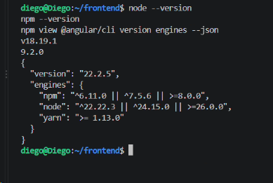

## Instalación y Verificación de Angular CLI

Se realizó con éxito la instalación global de **Angular CLI** utilizando el gestor de paquetes `npm` dentro del entorno de **ubuntu**. Posteriormente, se verificó la versión exacta de la herramienta mediante el comando `ng version` y se confirmó la ruta activa del ejecutable en el sistema mediante `command -v ng`, asegurando que el entorno quede completamente preparado para la inicialización y gestión del proyecto en la carpeta `frontend`.

```         
npm install -g @angular/cli
ng version
command -v ng
```

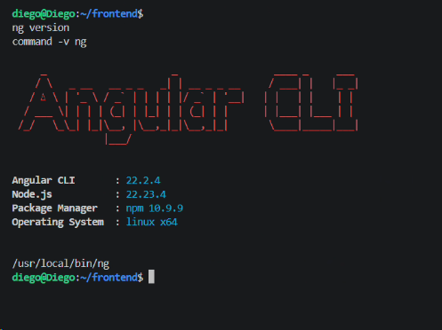

# ISS-01 · Bootstrap Angular 22 con CLI

## Inicialización de la Estructura Base de Angular

Se ejecutó la creación e inicialización formal del proyecto frontend en **Angular 22** dentro de la carpeta aislada `~/frontend/` utilizando **Angular CLI** de forma automatizada. Mediante esta configuración se habilitó el sistema de enrutamiento nativo (`--routing`), se estableció **CSS** como preprocesador de estilos y se omitió la ejecución de Renderizado del Lado del Servidor (`--ssr=false`), garantizando una arquitectura cliente limpia y lista para la integración de librerías de diseño como **Bootstrap**.

```         
cd ~/frontend
ng new . \
  --directory . \
  --style=css \
  --routing \
  --ssr=false \
  --skip-git \
  --package-manager=npm \
  --defaults
```

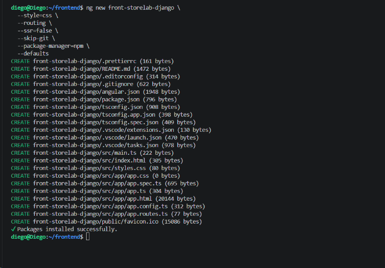

## Instalación e Integración de Bootstrap y Recursos Visuales

Se ingresó al directorio raíz del proyecto Angular (`front-storelab-django`) y se realizó la instalación global de las dependencias UI mediante `npm`, integrando **Bootstrap**, **PopperJS** y la suite de **Bootstrap Icons**. Esta configuración proporciona los archivos de diseño y componentes necesarios para construir la interfaz gráfica del sistema.

```         
npm install bootstrap @popperjs/core bootstrap-icons
```

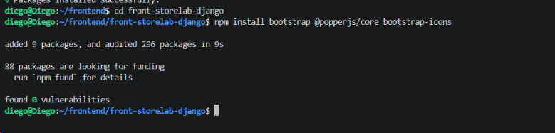

## Verificación Integral y Pruebas de Humo del Frontend

Se ejecutó el conjunto final de validaciones y pruebas de integración sobre el proyecto Angular `front-storelab-django`. Esto incluyó una compilación completa para producción con `ng build` para asegurar la correcta integración de los recursos de diseño, la ejecución y aprobación exitosa de las pruebas unitarias mediante `ng test`, y la verificación de disponibilidad y respuesta del servidor local de desarrollo, garantizando que el entorno frontend cumple con todos los estándares requeridos para avanzar al siguiente módulo.

```         
ng build
npm test -- --watch=false
npm ls primeng @primeuix/themes primeicons @angular/cdk tailwindcss --depth=0
curl -s -o /dev/null -w "%{http_code}\n" http://127.0.0.1:4200/
```

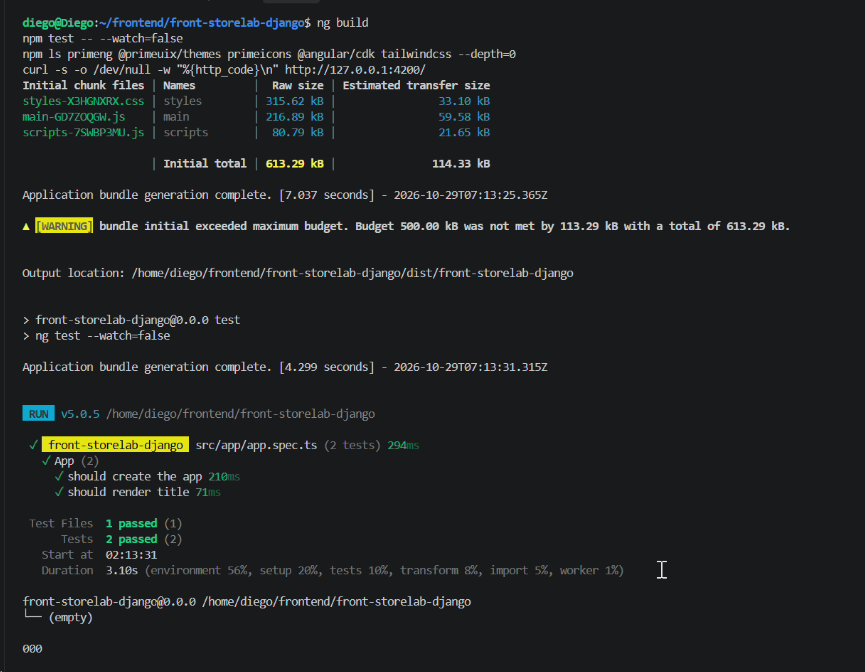

# ISS-01A · Esqueleto Header / Aside / contenido / Footer

## Creación de Componentes de Maquetación Básica

Se generaron los componentes modulares de la arquitectura de la interfaz gráfica dentro de la carpeta `src/app/layout/` utilizando **Angular CLI**. La creación de los componentes independientes `header`, `aside` y `footer` mediante el uso de la bandera `--skip-tests` permite mantener una estructura limpia y optimizada, sentando las bases del esqueleto visual que compondrá la navegación y el diseño general de la aplicacion.

```         
ng generate component layout/header --skip-tests --defaults
ng generate component layout/aside --skip-tests --defaults
ng generate component layout/footer --skip-tests --defaults
```

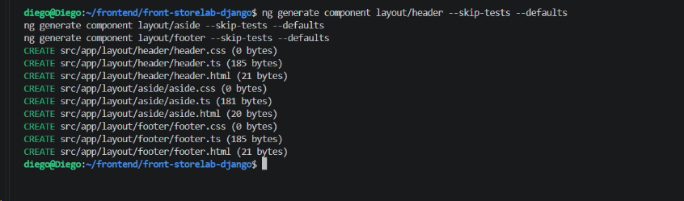

## Compilación y Ejecución del Servidor de Desarrollo

Se ejecutó el comando de compilación en tiempo real para verificar la correcta integración de los componentes del esqueleto maestro (`header`, `aside` y `footer`) junto con el enrutador y las hojas de estilos de Bootstrap, asegurando la visualización correcta de la interfaz base del sistema.

```         
ng serve 
```

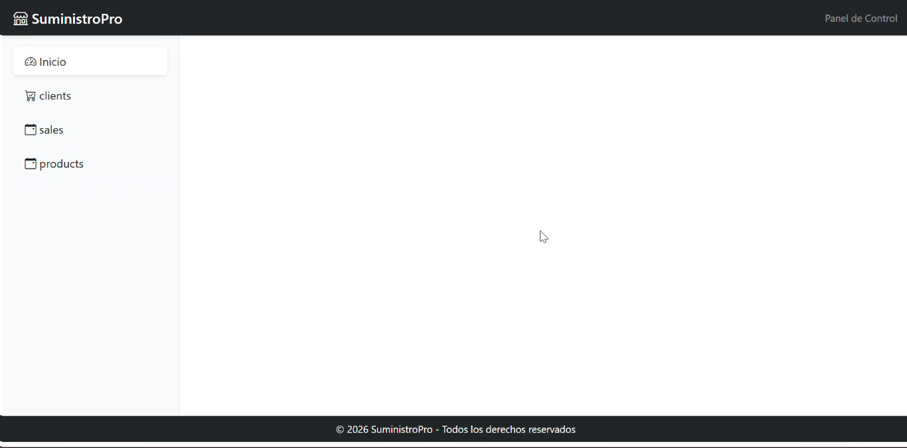](images/clipboard-1332509803.png)

## Ejecución de Comprobación y Verificación Integral del Proyecto

Se ejecutó una secuencia de comandos de validación en la terminal para comprobar de forma integral el estado del proyecto: se verificó el empaquetado con el compilador de producción (`ng build`), la ejecución exitosa de las pruebas unitarias sin supervisión en vivo (`npm test`), la integridad estructural de las carpetas y archivos de los componentes de diseño (`header`, `aside` y `footer`), la presencia de bloques de estilos CSS y la ausencia de referencias temporales en la plantilla principal (`app.component.html`).

```         
ng build
npm test -- --watch=false
ls src/app/layout/header src/app/layout/aside src/app/layout/footer
grep -c '[{}]' src/app/layout/*/*.css
grep -c 'app-ejemplo' src/app/app.html || echo 'no aparece: correcto'
```

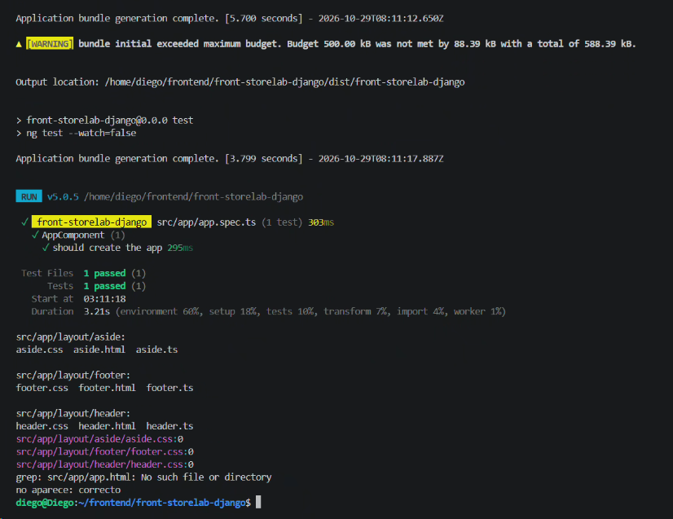](images/clipboard-4089453755.png)

# ISS-01B · Menú PrimeNG y primera interacción

## Implementación del Componente Aside con PrimeNG y Signals

Se configuró y estructuró el componente lateral (`Aside`) utilizando componentes independientes (*standalone*), el módulo de menús desplegables de PrimeNG (`PanelMenuModule`) y el sistema moderno de señales (`input` y `output`) de Angular. Asimismo, se actualizó la plantilla HTML asociada para incorporar la barra de navegación basada en modelos dinámicos, el manejo de eventos de clic optimizado con `closest` y los bloques condicionales de sesión para el panel administrativo del proyecto.

src/app/layout/aside/aside.ts

```         
import { Component, input, output } from '@angular/core';
import { MenuItem } from 'primeng/api';
import { ButtonModule } from 'primeng/button';
import { PanelMenuModule } from 'primeng/panelmenu';

/**
 * Menú lateral de la aplicación.
 *
 * Presentación pura: recibe el menú ya construido por `input()` y avisa de la
 * navegación con `output()`. No conoce rutas, permisos ni la API.
 */
@Component({
  host: { class: 'block h-full' },
  selector: 'app-aside',
  imports: [ButtonModule, PanelMenuModule],
  templateUrl: './aside.html',
  styleUrl: './aside.css',
})
export class Aside {
  readonly appName = input('StoreLab');

  /** Opciones del menú, en el formato `MenuItem` de PrimeNG. */
  readonly items = input<MenuItem[]>([]);

  /** Datos de sesión con valores por defecto: ISS-08 los completa. */
  readonly showSession = input(false);
  readonly username = input('');
  readonly roleLabel = input('Sin rol');
  readonly permissionCount = input(0);

  /** Aviso al padre: se seleccionó una opción (lo usa el Drawer en móvil). */
  readonly navigated = output<void>();

  /** Aviso al padre: se pidió cerrar sesión. */
  readonly logoutRequested = output<void>();

  /**
   * Un clic dentro del menú puede caer en el propio ítem o en un hijo suyo.
   * `closest` resuelve ambos casos con un solo listener en el `<nav>`.
   */
  onNavigationClick(event: Event): void {
    if ((event.target as HTMLElement).closest('a, button, [role="button"]')) {
      this.navigated.emit();
    }
  }
}
```

src/app/layout/aside/aside.html

```         
<div class="flex h-full flex-col border-r border-slate-200 bg-white text-slate-900">
  <div class="flex h-16 items-center gap-3 border-b border-slate-200 px-5">
    
    <div class="min-w-0">
      <p class="truncate text-sm font-semibold text-slate-900">{{ appName() }}</p>
      <p class="text-[11px] uppercase tracking-wider text-slate-400">
        Panel administrativo
      </p>
    </div>
  </div>

  <div class="flex-1 overflow-y-auto p-3">
    <nav aria-label="Navegación principal" (click)="onNavigationClick($event)">
      <p-panelmenu [model]="items()" [multiple]="true" />
    </nav>
  </div>

  @if (showSession()) {
    <div class="border-t border-slate-200 p-4">
      <p class="text-sm font-medium text-slate-900">{{ username() || 'Invitado' }}</p>
      <p class="text-xs text-slate-400">{{ roleLabel() }}</p>
      <div class="mt-3 flex items-center justify-between text-xs text-slate-400">
        <span>{{ permissionCount() }} permisos</span>
        <button
          pButton
          type="button"
          text
          rounded
          aria-label="Cerrar sesión"
          (click)="logoutRequested.emit()"
        >
          <i pButtonIcon class="pi pi-sign-out"></i>
        </button>
      </div>
    </div>
  }
</div>
```

## Implementación del Componente Header con PrimeNG y Signals

Se programó y estructuró el componente de la barra superior (`Header`) utilizando componentes independientes (*standalone*), módulos de interfaz de PrimeNG (`AvatarModule`, `ButtonModule`, `MenuModule` y `TagModule`) y el modelo de señales (`input` y `output`) de Angular. Asimismo, se integró la plantilla HTML correspondiente para gestionar de forma reactiva el menú desplegable de usuario, los botones de navegación colapsable y los indicadores de sesión del sistema administrativo.

src/app/layout/header/header.ts

```         
import { Component, input, output } from '@angular/core';
import { MenuItem } from 'primeng/api';
import { AvatarModule } from 'primeng/avatar';
import { ButtonModule } from 'primeng/button';
import { MenuModule } from 'primeng/menu';
import { TagModule } from 'primeng/tag';

/**
 * Barra superior de la aplicación.
 *
 * Es presentación pura: recibe los datos por `input()` y avisa al padre con
 * `output()`. No inyecta servicios, no consulta la API y no conoce permisos.
 */
@Component({
  host: { class: 'block' },
  selector: 'app-header',
  imports: [AvatarModule, ButtonModule, MenuModule, TagModule],
  templateUrl: './header.html',
  styleUrl: './header.css',
})
export class Header {
  /** Nombre visible de la aplicación. */
  readonly appName = input('StoreLab');

  /** Datos de sesión con valores por defecto: ISS-08 los completa. */
  readonly username = input('');
  readonly initials = input('IN');
  readonly roleLabel = input('Sin rol');
  readonly authEnabled = input(true);
  readonly showSession = input(false);
  readonly userItems = input<MenuItem[]>([]);

  /** Aviso al padre: el botón de menú se pulsó. El padre decide aside fijo o Drawer. */
  readonly menuRequested = output<void>();
}
```

src/app/layout/header/header.html

```         
<header
  class="sticky top-0 z-30 flex h-16 items-center gap-3 border-b border-slate-200 bg-white px-4 sm:px-6"
>
  <!-- Botón de menú: siempre visible; el padre decide qué hacer (aside fijo o Drawer). -->
  <button
    pButton
    type="button"
    text
    rounded
    aria-label="Mostrar u ocultar el menú"
    (click)="menuRequested.emit()"
  >
    <i pButtonIcon class="pi pi-bars"></i>
  </button>

  <div class="min-w-0 flex-1">
    <p class="truncate text-sm font-semibold text-slate-900">{{ appName() }}</p>
    <p class="truncate text-xs text-slate-500">
      Gestión de clientes, productos y ventas
    </p>
  </div>

  @if (showSession() && !authEnabled()) {
    <p-tag value="Fase I · sin auth" severity="warn" [rounded]="true" />
  }
  @if (username()) {
    <p-tag
      [value]="roleLabel()"
      severity="info"
      [rounded]="true"
      class="hidden sm:inline-flex"
    />
  }

  @if (showSession()) {
    <button
      pButton
      type="button"
      severity="secondary"
      outlined
      (click)="userMenuPanel.toggle($event)"
      aria-label="Menú de usuario"
    >
      <p-avatar [label]="initials()" shape="circle" size="normal" />
      <span class="hidden max-w-32 truncate text-sm font-medium text-slate-700 sm:block">
        {{ username() }}
      </span>
      <i class="pi pi-chevron-down pr-1 text-[10px] text-slate-400"></i>
    </button>
    <p-menu #userMenuPanel [model]="userItems()" [popup]="true" appendTo="body" />
  }
</header>
```

## Generación del Módulo de Características

Se ejecutó el comando de generación de componentes de Angular en la terminal para crear la estructura base del módulo de características (*features/construir*), omitiendo los archivos de prueba innecesarios y aplicando la configuración por defecto para mantener la modularidad y el orden dentro de la arquitectura del proyecto.

```         
ng generate component features/construir --skip-tests --defaults
```

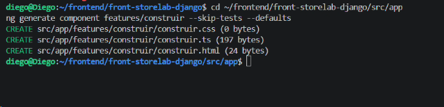

src/app/features/construir/construir.ts

```         
import { Component, signal } from '@angular/core';
import { MenuItem } from 'primeng/api';
import { ButtonModule } from 'primeng/button';
import { CardModule } from 'primeng/card';
import { DrawerModule } from 'primeng/drawer';
import { watchMediaQuery } from '../../core/utils/media-query';
import { Aside } from '../../layout/aside/aside';
import { Footer } from '../../layout/footer/footer';
import { Header } from '../../layout/header/header';

/**
 * Pantalla del prototipo.
 *
 * Es el único componente con estado en ISS-01B: guarda el título elegido y el
 * estado del menú. El layout solo recibe datos por `input()`; así en ISS-02 se
 * puede reutilizar sin duplicar Header, Aside ni Footer.
 */
@Component({
  host: { class: 'block' },
  selector: 'app-construir',
  imports: [Aside, ButtonModule, CardModule, DrawerModule, Footer, Header],
  templateUrl: './construir.html',
  styleUrl: './construir.css',
})
export class Construir {
  /** `lg` de Tailwind: desde aquí el Aside es fijo y el botón lo alterna. */
  private readonly isDesktop = watchMediaQuery('(min-width: 1024px)');

  /** Escritorio: el Aside fijo se oculta y el contenido se ensancha. */
  readonly sidebarCollapsed = signal(false);

  /** Móvil: el Drawer se abre desde el botón y se cierra al elegir una opción. */
  readonly mobileOpen = signal(false);

  /** Título del contenido. Cambia al elegir una opción del menú, sin HTTP. */
  readonly title = signal('Inicio');

  /**
   * Menú en el formato `MenuItem` de PrimeNG.
   *
   * `command` ejecuta una función al elegir la opción. Todavía no navega: solo
   * cambia el título. En ISS-02 cada comando apuntará a una ruta real.
   */
  readonly items: MenuItem[] = [
    { label: 'Inicio', icon: 'pi pi-home', command: () => this.seleccionar('Inicio') },
    { label: 'Clientes', icon: 'pi pi-users', command: () => this.seleccionar('Clientes') },
    {
      label: 'Tipos de producto',
      icon: 'pi pi-tags',
      command: () => this.seleccionar('Tipos de producto'),
    },
    { label: 'Productos', icon: 'pi pi-box', command: () => this.seleccionar('Productos') },
    { label: 'Ventas', icon: 'pi pi-shopping-cart', command: () => this.seleccionar('Ventas') },
  ];

  /**
   * Un solo botón, dos disposiciones: en escritorio alterna el Aside fijo; por
   * debajo de `lg` abre el Drawer (donde el Aside fijo no cabe).
   */
  protected onMenuToggle(): void {
    if (this.isDesktop()) {
      this.sidebarCollapsed.update((collapsed) => !collapsed);
      return;
    }
    this.mobileOpen.set(true);
  }

  /** Una sola puerta de entrada al estado: la usan los cinco comandos. */
  protected seleccionar(titulo: string): void {
    this.title.set(titulo);
    this.mobileOpen.set(false);
  }
}
```

### El helper que decide el ancho

`src/app/core/utils/media-query.ts`

```         
import { DestroyRef, Signal, inject, signal } from '@angular/core';

/**
 * Observa una media query CSS y la expone como signal de solo lectura.
 */
export function watchMediaQuery(query: string): Signal<boolean> {
  const destroyRef = inject(DestroyRef);

  const media =
    typeof window !== 'undefined' && typeof window.matchMedia === 'function'
      ? window.matchMedia(query)
      : null;

  const matches = signal(media?.matches ?? false);

  if (media) {
    const listener = (event: MediaQueryListEvent): void => matches.set(event.matches);
    media.addEventListener('change', listener);
    destroyRef.onDestroy(() => media.removeEventListener('change', listener));
  }

  return matches.asReadonly();
}
```

> **Alternativa que se descartó.** Se podría dejar que la media query la resolviera el CSS y el padre no supiera el ancho… pero entonces el mismo botón debería servir para dos cosas distintas sin poder distinguirlas. La consulta en TypeScript es explícita y comprobable.

`src/app/features/construir/construir.html`

```         
<div class="flex min-h-screen flex-col bg-slate-100">
  <app-header (menuRequested)="onMenuToggle()" />

  <div class="flex flex-1">
    <!--
      Escritorio: Aside fijo que el botón del Header puede ocultar.
      Por debajo de lg no se pinta: el menú vive en el Drawer.
    -->
    @if (!sidebarCollapsed()) {
      <aside class="hidden w-72 shrink-0 lg:block">
        <app-aside [items]="items" (navigated)="mobileOpen.set(false)" />
      </aside>
    }

    <main id="contenido" class="min-w-0 flex-1 p-4 sm:p-6">
      <p-card class="block">
        <h1 class="text-2xl font-semibold text-slate-900">{{ title() }}</h1>
        <p class="mt-3 text-slate-600">
          Bienvenido a StoreLab. Elige una opción del menú para explorar la estructura.
        </p>
        <p class="mt-2 text-sm text-slate-500">
          Esta primera pantalla usa datos locales. Los formularios y la conexión con la API
          Django se incorporan después.
        </p>
      </p-card>
    </main>
  </div>

  <app-footer />
</div>

<!-- Móvil: el mismo Aside, otra disposición. -->
<p-drawer [(visible)]="mobileOpen" header="Menú" position="left" styleClass="w-72">
  <app-aside [items]="items" (navigated)="mobileOpen.set(false)" />
</p-drawer>
```

## Creación del Archivo de Pruebas Unitarias para el Componente Construir

Se añadió el archivo de pruebas unitarias correspondiente al módulo de características (`construir.spec.ts`) para asegurar la cobertura de pruebas y el correcto ciclo de vida del componente dentro de la arquitectura modular del proyecto.

src/app/features/construir/construir.spec.ts

```         
import { TestBed } from '@angular/core/testing';
import { Construir } from './construir';

/**
 * jsdom no implementa `matchMedia`, así que `watchMediaQuery` devuelve `false`
 * y el componente se comporta como móvil. El caso de escritorio se prueba aquí
 * sustituyendo la función antes de crear el componente.
 */
function stubDesktopMedia(matches: boolean): () => void {
  const original = window.matchMedia;

  Object.defineProperty(window, 'matchMedia', {
    configurable: true,
    writable: true,
    value: (query: string) =>
      ({
        matches,
        media: query,
        addEventListener: () => undefined,
        removeEventListener: () => undefined,
      }) as unknown as MediaQueryList,
  });

  return () => {
    Object.defineProperty(window, 'matchMedia', {
      configurable: true,
      writable: true,
      value: original,
    });
  };
}

describe('Construir', () => {
  beforeEach(async () => {
    await TestBed.configureTestingModule({
      imports: [Construir],
    }).compileComponents();
  });

  async function crearPantalla() {
    const fixture = TestBed.createComponent(Construir);
    await fixture.whenStable();
    return { fixture, compilado: fixture.nativeElement as HTMLElement };
  }

  function botonMenu(compilado: HTMLElement): HTMLButtonElement {
    const boton = compilado.querySelector(
      'app-header button[aria-label="Mostrar u ocultar el menú"]',
    );
    expect(boton).toBeTruthy();
    return boton as HTMLButtonElement;
  }

  function opcionDelMenu(compilado: HTMLElement, etiqueta: string): HTMLElement {
    const opcion = [...compilado.querySelectorAll('a, button')].find(
      (elemento) => elemento.textContent?.trim() === etiqueta,
    );
    expect(opcion).toBeTruthy();
    return opcion as HTMLElement;
  }

  it('should compose the layout and start on Inicio', async () => {
    const { compilado } = await crearPantalla();

    expect(compilado.querySelector('app-header')).toBeTruthy();
    expect(compilado.querySelector('aside app-aside')).toBeTruthy();
    expect(compilado.querySelector('app-footer')).toBeTruthy();
    expect(compilado.querySelector('main h1')?.textContent).toContain('Inicio');
  });

  it('should render the five menu options', async () => {
    const { compilado } = await crearPantalla();
    const texto = compilado.textContent ?? '';

    for (const etiqueta of ['Inicio', 'Clientes', 'Tipos de producto', 'Productos', 'Ventas']) {
      expect(texto).toContain(etiqueta);
    }
  });

  it('should always show the menu button, not only on small screens', async () => {
    const { compilado } = await crearPantalla();

    // `lg:hidden` ocultaba el botón justo cuando el Aside ya era visible.
    expect(botonMenu(compilado).classList.contains('lg:hidden')).toBe(false);
  });

  it('should change the title without navigating when an option is chosen', async () => {
    const { fixture, compilado } = await crearPantalla();

    opcionDelMenu(compilado, 'Clientes').click();
    fixture.detectChanges();
    await fixture.whenStable();

    expect(compilado.querySelector('main h1')?.textContent).toContain('Clientes');
    // Sigue en la misma pantalla: no hay recarga ni petición HTTP.
    expect(compilado.querySelector('app-construir, main')).toBeTruthy();
  });

  it('should open the mobile drawer when the header requests it', async () => {
    const { fixture, compilado } = await crearPantalla();
    const componente = fixture.componentInstance as unknown as {
      mobileOpen: () => boolean;
    };

    expect(componente.mobileOpen()).toBe(false);

    const botonMenu = compilado.querySelector(
      'app-header button[aria-label="Mostrar u ocultar el menú"]',
    ) as HTMLButtonElement;
    expect(botonMenu).toBeTruthy();

    botonMenu.click();
    fixture.detectChanges();
    await fixture.whenStable();

    expect(componente.mobileOpen()).toBe(true);
  });

  it('should hide the fixed aside on desktop instead of opening the drawer', async () => {
    const restaurar = stubDesktopMedia(true);

    try {
      const { fixture, compilado } = await crearPantalla();
      expect(compilado.querySelector('aside app-aside')).toBeTruthy();

      botonMenu(compilado).click();
      fixture.detectChanges();
      await fixture.whenStable();

      expect(fixture.componentInstance.sidebarCollapsed()).toBe(true);
      expect(compilado.querySelector('aside')).toBeNull();
      expect(fixture.componentInstance.mobileOpen()).toBe(false);
    } finally {
      restaurar();
    }
  });

  it('should close the drawer after choosing an option', async () => {
    const { fixture, compilado } = await crearPantalla();
    const componente = fixture.componentInstance as unknown as {
      mobileOpen: () => boolean;
    };

    botonMenu(compilado).click();
    fixture.detectChanges();
    await fixture.whenStable();
    expect(componente.mobileOpen()).toBe(true);

    opcionDelMenu(compilado, 'Productos').click();
    fixture.detectChanges();
    await fixture.whenStable();

    expect(componente.mobileOpen()).toBe(false);
    expect(compilado.querySelector('main h1')?.textContent).toContain('Productos');
  });
});
```

## Actualización y Refactorización del Componente Raíz

Se ajustó el componente raíz de la aplicación (`app.ts`) para soportar la nueva arquitectura modular y las señales de Angular, consolidando la integración de los elementos visuales principales del sistema.

src/app/app.ts

```         
import { Component } from '@angular/core';
import { RouterOutlet } from '@angular/router';

/**
 * Componente principal (`<app-root>`).
 *
 * Desde ISS-01B es solo el punto de entrada: el router elige qué componente se
 * dibuja dentro de `<router-outlet />` según la URL.
 */
@Component({
  host: { class: 'block' },
  selector: 'app-root',
  imports: [RouterOutlet],
  templateUrl: './app.html',
  styleUrl: './app.css',
})
export class App {}
```

src/app/app.html

```         
<!-- El router dibuja aquí el componente de la ruta activa (app.routes.ts). -->
<router-outlet />
```

src/app/app.routes.ts

```         
import { Routes } from '@angular/router';

/**
 * Rutas de la aplicación.
 *
 * ISS-01B presenta el router con una pantalla real. `loadComponent` descarga
 * `Construir` solo cuando se visita su URL: el bundle inicial no lo incluye.
 */
export const routes: Routes = [
  {
    path: 'construir',
    loadComponent: () =>
      import('./features/construir/construir').then((m) => m.Construir),
  },
  { path: '', pathMatch: 'full', redirectTo: 'construir' },
  { path: '**', redirectTo: 'construir' },
];
```

src/app/app.spec.ts

```         
import { TestBed } from '@angular/core/testing';
import { provideRouter } from '@angular/router';
import { App } from './app';

describe('App', () => {
  beforeEach(async () => {
    await TestBed.configureTestingModule({
      imports: [App],
      // Sin rutas: esta prueba comprueba el punto de entrada, no las pantallas.
      providers: [provideRouter([])],
    }).compileComponents();
  });

  it('should create the app', () => {
    const fixture = TestBed.createComponent(App);
    expect(fixture.componentInstance).toBeTruthy();
  });

  it('should render the router outlet', async () => {
    const fixture = TestBed.createComponent(App);
    await fixture.whenStable();
    const compilado = fixture.nativeElement as HTMLElement;
    expect(compilado.querySelector('router-outlet')).toBeTruthy();
  });
});
```

## Compilación y Empaquetado del Proyecto para Producción

Se ejecutó la prueba de compilación final de la aplicación mediante el comando de empaquetado del CLI de Angular, comprobando que la estructura modular, los componentes independientes de PrimeNG y las señales integradas construyan correctamente y sin errores de compilación para el entorno de producción en el proyecto

```         
ng build
```

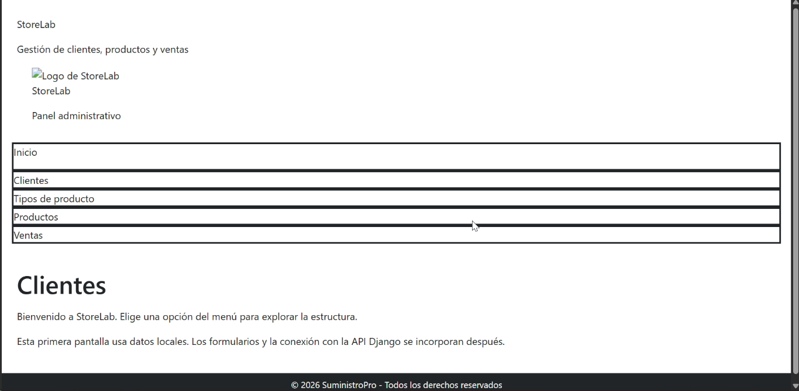](images/clipboard-3291701125.png)

# ISS-02 · Núcleo: environment, modelos, servicios y layout

## Generación de Entornos de Configuración para el Proyecto 

Se configuraron y establecieron los archivos de entorno de trabajo para el proyecto **tecnogua**, permitiendo definir de manera organizada las variables de conexión y parámetros específicos según el entorno de ejecución del sistema.

```         
ng generate environments
```

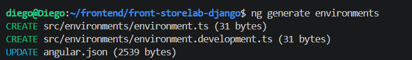

src/environments/environment.ts

```         
/**
 * `apiUrl` termina en `/api` SIN barra final: cada servicio añade la suya
 * (`${base}/`) porque todas las rutas del contrato terminan en `/`.
 */
export const environment = {
  production: true,
  appName: 'StoreLab',
  apiUrl: 'http://localhost:8000/api',
  /** Clave Community de PrimeUI. `''` deja el aviso en consola; la app funciona. */
  primeUiLicense: '',
};
```

environment.development.ts

```         
"development": {
  "optimization": false,
  "sourceMap": true,
  "fileReplacements": [
    {
      "replace": "src/environments/environment.ts",
      "with": "src/environments/environment.development.ts"
    }
  ]
}
```

## Generación de Modelos e Interfaces Base del Dominio 

Se ejecutaron los comandos del CLI de Angular para generar las interfaces y modelos tipados centrales ubicados en la ruta `src/app/core/models/`, estableciendo las estructuras de datos base para `api`, `client`, `product-type`, `product`, `sale`, `product-sale` y `auth`, lo cual garantiza un tipado estricto y desacoplado para la lógica de negocio del sistema.

```         
ng generate interface core/models/api --type=model --defaults
ng generate interface core/models/client --type=model --defaults
ng generate interface core/models/product-type --type=model --defaults
ng generate interface core/models/product --type=model --defaults
ng generate interface core/models/sale --type=model --defaults
ng generate interface core/models/product-sale --type=model --defaults
ng generate interface core/models/auth --type=model --defaults
```

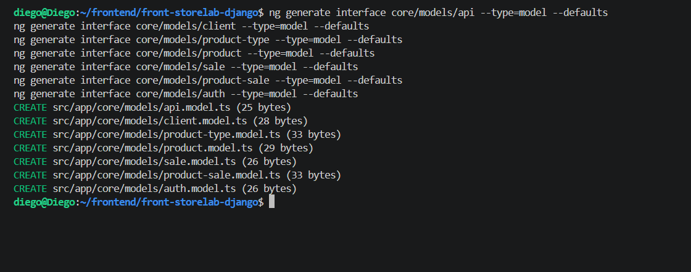

src/app/core/models/api.model.ts

```         
/** Estado único del contrato: la baja es lógica, nunca borra la fila. */
export type Status = 'active' | 'inactive';

/** Importe tal como viaja: string decimal ("12.50"). Nunca se opera con float. */
export type Money = string;

/** Métodos de `resources.method` (Fase II). */
export type HttpMethod = 'GET' | 'POST' | 'PUT' | 'PATCH' | 'DELETE';

/** Fechas del contrato: ISO-8601 con zona. */
export interface Timestamps { createdAt?: string; updatedAt?: string; }

/** Cuerpo de error: `{ "detail": "..." }` o `{ "campo": ["mensaje"] }`. */
export interface ApiError { detail?: string; }

/** Importe del contrato a número, para sumar o comparar en el dashboard. */
export function toNumber(value: Money | number | null | undefined): number {
  const parsed = Number(value ?? 0);
  return Number.isFinite(parsed) ? parsed : 0;
}
```

`client.model.ts` y `product-type.model.ts`

```         
import { Status, Timestamps } from './api.model';

/** Tabla `clients` — /api/clients/. `password` es de solo escritura y la UI no lo pide. */
export interface Client extends Timestamps {
  id: number; name: string; address: string | null; phone: string | null;
  email: string | null; status: Status;
}

/** Cuerpo de `POST` y `PATCH`: sin `id` y sin `status` (lo cambia la baja). */
export interface ClientPayload {
  name: string; address: string | null; phone: string | null; email: string | null;
}
```

```         
import { Status, Timestamps } from './api.model';

/** Tabla `product_types` — /api/product-types/. `name` NO es único. */
export interface ProductType extends Timestamps {
  id: number; name: string; description: string | null; status: Status;
}

export interface ProductTypePayload { name: string; description: string | null; }
```

`product.model.ts` — `productTypeId` al escribir; `productTypeName` solo al leer.

```         
import { Money, Status, Timestamps } from './api.model';

/** Tabla `products` — /api/products/. */
export interface Product extends Timestamps {
  id: number; productTypeId: number; productTypeName?: string;
  name: string; brand: string; price: Money;
  minStock: number;  // umbral de reposición
  quantity: number;  // existencia actual
  status: Status;
}

export interface ProductPayload {
  productTypeId: number; name: string; brand: string;
  price: Money; minStock: number; quantity: number;
}
```

`product-sale.model.ts` y `sale.model.ts` — la venta y sus líneas.

```         
import { Money, Status, Timestamps } from './api.model';

/** Tabla `product_sales`: una fila es una línea de venta. */
export interface ProductSale extends Timestamps {
  id: number; saleId: number; productId: number; quantity: number;
  unitPrice: Money;  // copia del precio vigente: inmutable
  lineTotal: Money;  // quantity × unitPrice; lo calcula el servidor
  status: Status;
}

/** Línea tal como llega dentro de `sale.items`. */
export type SaleItemLine = Pick<
  ProductSale, 'productId' | 'quantity' | 'unitPrice' | 'lineTotal'
>;

/** Línea que envía el cliente: solo producto y cantidad. */
export interface SaleItemInput { productId: number; quantity: number; }
```

```         
import { Money, Status, Timestamps } from './api.model';
import { SaleItemInput, SaleItemLine } from './product-sale.model';

/** Tabla `sales` — /api/sales/. El listado ya trae `items`: el detalle no repite la llamada. */
export interface Sale extends Timestamps {
  id: number; clientId: number; saleDate: string;
  subtotal: Money; tax: Money; discounts: Money; total: Money;
  status: Status; items?: SaleItemLine[];
}

/** POST /api/sales/: el servidor calcula importes, totales y stock. */
export interface SaleCreatePayload {
  clientId: number; saleDate: string; discounts: Money; items: SaleItemInput[];
}
```

`auth.model.ts` — usuario, tokens y permiso efectivo.

```         
import { HttpMethod, Status, Timestamps } from './api.model';

/** GET /api/auth/profile/: el usuario llega directo, sin envoltorio `user`. */
export interface User extends Timestamps {
  id: number; username: string; email: string; avatar: string | null; status: Status;
}

/** Login y refresh comparten cuerpo; el refresh rota en cada uso. */
export interface SessionTokens {
  access: string; refresh: string; tokenType: 'Bearer'; accessExpiresIn: number;
}

/** Una fila de `GET /api/auth/permissions/`. La clave es `method + ' ' + path`. */
export interface EffectivePermission {
  method: HttpMethod; path: string; roleId: number; roleName: string;
}
```

## Generación de Servicios API de Clientes, Productos y Ventas 

Se ejecutaron los comandos del CLI de Angular para generar la capa de servicios API orientada a la comunicación con el backend, creando de forma modular y sin pruebas unitarias predeterminadas (`--skip-tests`) los servicios para `client-api`, `product-type-api`, `product-api`, `sale-api` y `product-sale-api` dentro del proyecto.

```         
ng generate service features/clients/client-api --skip-tests --defaults
ng generate service features/product-types/product-type-api --skip-tests --defaults
ng generate service features/products/product-api --skip-tests --defaults
ng generate service features/sales/sale-api --skip-tests --defaults
ng generate service features/product-sales/product-sale-api --skip-tests --defaults
 
```

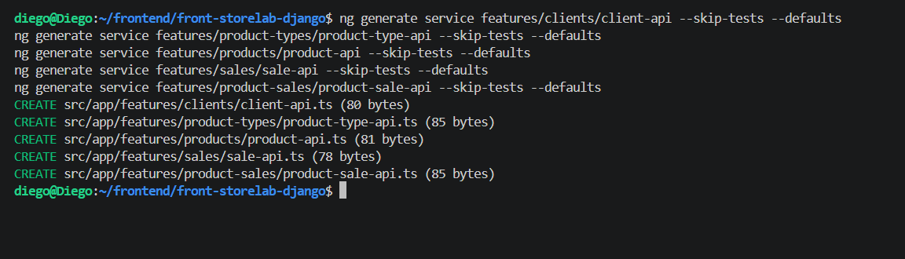

src/app/features/clients/client-api.ts

```         
import { HttpClient } from '@angular/common/http';
import { Injectable, inject } from '@angular/core';
import { Observable } from 'rxjs';
import { environment } from '../../../environments/environment';
import { Status } from '../../core/models/api.model';
import { Client, ClientPayload } from '../../core/models/client.model';

/** Único punto de contacto con `/api/clients/`. */
@Injectable({ providedIn: 'root' })
export class ClientApi {
  private readonly http = inject(HttpClient);
  /** Sin barra final: el sufijo `/` se agrega en cada método, a la vista. */
  private readonly base = `${environment.apiUrl}/clients`;

  list(): Observable<Client[]> {
    return this.http.get<Client[]>(`${this.base}/`);
  }

  get(id: number): Observable<Client> {
    return this.http.get<Client>(`${this.base}/${id}/`);
  }

  /** El alta envía `status: 'active'`: en la base el registro nace `inactive`. */
  create(payload: ClientPayload & { status: Status }): Observable<Client> {
    return this.http.post<Client>(`${this.base}/`, payload);
  }

  /** PATCH: el formulario envía solo los campos que cambiaron. */
  update(id: number, payload: Partial<ClientPayload>): Observable<Client> {
    return this.http.patch<Client>(`${this.base}/${id}/`, payload);
  }

  /** DELETE: baja lógica, responde 204 sin cuerpo. */
  remove(id: number): Observable<void> {
    return this.http.delete<void>(`${this.base}/${id}/`);
  }
}
```

## Generación de Componentes UI Compartidos

Se ejecutaron los comandos del CLI de Angular para generar la infraestructura de componentes visuales reutilizables orientados a la interfaz de usuario, creando de manera modular y sin pruebas unitarias predeterminadas (`--skip-tests`) los componentes `status-tag`, `page-header` y `empty-state` dentro de la ruta compartida de componentes del proyecto

```         
ng generate component shared/ui/status-tag --skip-tests --defaults
ng generate component shared/ui/page-header --skip-tests --defaults
ng generate component shared/ui/empty-state --skip-tests --defaults
```

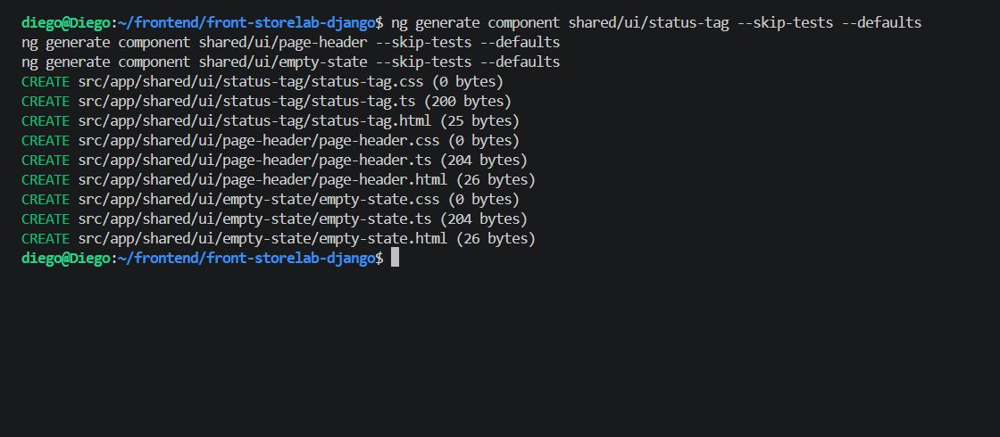

src/app/shared/ui/status-tag/status-tag.ts

```         
import { Component, computed, input } from '@angular/core';
import { TagModule } from 'primeng/tag';
import { Status } from '../../../core/models/api.model';

/** Estado de un registro: `active` o `inactive`. No conoce la API. */
@Component({
  selector: 'app-status-tag',
  imports: [TagModule],
  template: `<p-tag [value]="label()" [severity]="severity()" />`,
  host: { class: 'inline-block' },
})
export class StatusTag {
  readonly status = input.required<Status>();
  readonly label = computed(() => (this.status() === 'active' ? 'Activo' : 'Inactivo'));
  readonly severity = computed(() => (this.status() === 'active' ? 'success' : 'danger'));
}
```

src/app/shared/ui/page-header/page-header.ts

```         
import { Component, input } from '@angular/core';

/** Título, descripción y acciones de una pantalla. Proyecta los botones. */
@Component({
  selector: 'app-page-header',
  template: `
    <header class="flex flex-col gap-2 md:flex-row md:items-end md:justify-between">
      <div class="flex flex-col gap-1">
        <h1 class="text-2xl font-semibold text-slate-900">{{ title() }}</h1>
        @if (subtitle()) { <p class="text-sm text-slate-500">{{ subtitle() }}</p> }
      </div>
      <div class="flex flex-wrap gap-2"><ng-content /></div>
    </header>
  `,
  host: { class: 'block' },
})
export class PageHeader {
  readonly title = input.required<string>();
  readonly subtitle = input('');
}
```

src/app/shared/ui/empty-state/empty-state.ts

```         
import { Component, input } from '@angular/core';

/** Lista vacía o sin coincidencias. Nunca sustituye al mensaje de error. */
@Component({
  selector: 'app-empty-state',
  template: `
    <div class="flex flex-col items-center gap-2 py-10 text-center">
      <i [class]="icon() + ' text-4xl text-slate-300'"></i>
      <p class="font-medium text-slate-600">{{ title() }}</p>
      <p class="text-sm text-slate-500">{{ message() }}</p>
    </div>
  `,
})
export class EmptyState {
  readonly icon = input('pi pi-inbox');
  readonly title = input.required<string>();
  readonly message = input('');
}
```

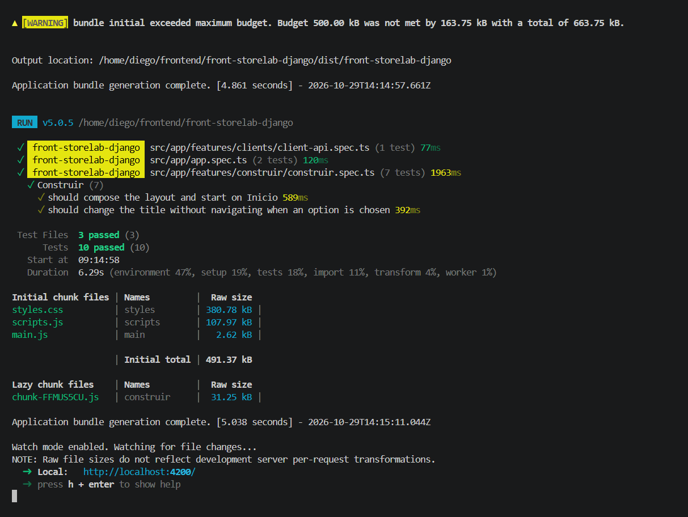](images/clipboard-4086183690.png)
