# Django + DRF (StoreLab)

## ISS-00 — Entorno y proyecto Django

## crea el entorno y el proyecto

En este único paso unificado, creamos el entorno virtual (.venv), lo activamos, instalamos una versión específica de Django (5.2.17), inicializamos el proyecto nombrando a la carpeta principal como "config", guardamos las dependencias instaladas en un archivo de requerimientos (requirements.txt) y finalmente verificamos que la instalación de Django haya quedado correcta. Código utilizado:

```         
python3 -m venv .venv
source .venv/bin/activate
python -m pip install "Django==5.2.17"
django-admin startproject config .
python -m pip freeze > requirements.txt
python -m django --version
```

## evidencias

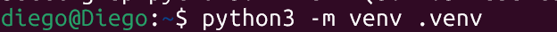

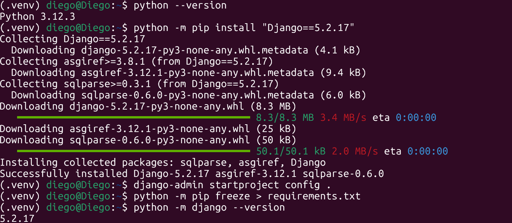](images/clipboard-136647585.png)

## en caso de no tener instalado python utiliza el siguiente comando

```         
sudo apt install python3.12-venv
```

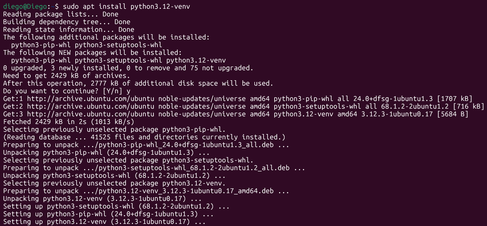

## Configuración del Archivo de Exclusión

Para mantener un repositorio limpio y seguro, es fundamental evitar subir archivos innecesarios, datos sensibles o entornos locales al sistema de control de versiones. Mediante este comando generamos el archivo .gitignore, el cual le indica a Git qué carpetas y archivos debe ignorar automáticamente, tales como el entorno virtual, credenciales del entorno (.env), la base de datos local SQLite, archivos de caché de Python y configuraciones del editor de código. Código utilizado:

```         
cat > .gitignore <<'EOF'
.venv/
__pycache__/
*.py[cod]
.env
db.sqlite3
*.log
.idea/
.vscode/
staticfiles/
media/
.pytest_cache/
htmlcov/
.coverage
EOF
```

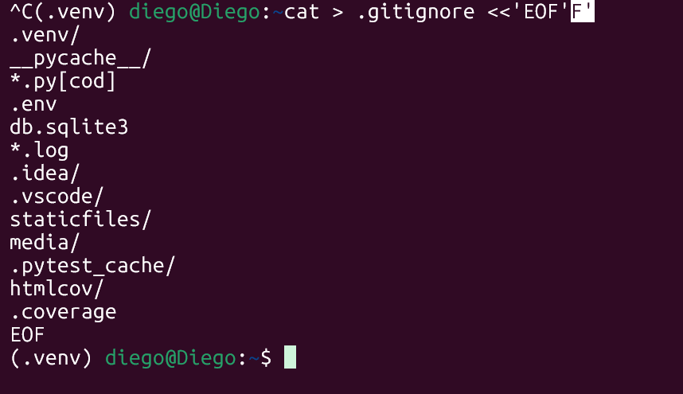

## Verificación

```         
python -m django --version
python manage.py check
```

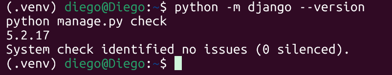

# ISS-01 — Settings y selección del motor

## Preparación del entorno: dependencias del sistema y paquetes pip

Instalación de dependencias del sistema operativo (paquetes de compilación y cabeceras de desarrollo de MySQL y Python) necesarias en el entorno de Ubuntu (WSL) para compilar correctamente las librerías nativas requeridas por el proyecto.

```         
sudo apt install build-essential pkg-config default-libmysqlclient-dev python3.12-dev
```

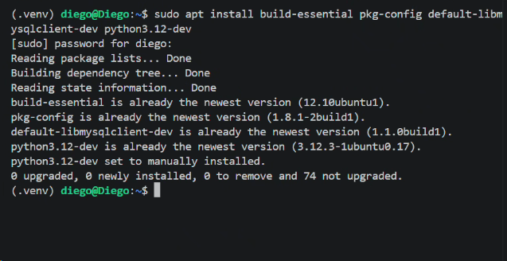

## Instalación de librerías y conectores en el entorno virtual

Instalación secuencial en el entorno virtual de los paquetes necesarios para el proyecto: la librería para la gestión de variables de entorno (python-dotenv), los conectores oficiales para bases de datos relacionales (psycopg para PostgreSQL, mysqlclient para MySQL, mssql-django para SQL Server y oracledb para Oracle), y finalmente la exportación del listado completo de dependencias fijadas al archivo requirements.txt.

```         
python -m pip install "python-dotenv==1.2.3"
python -m pip install "psycopg[binary]==3.3.6"
python -m pip install "mysqlclient==2.3.0"
python -m pip install "mssql-django==2.0.0"
python -m pip install "oracledb==26.0.1"
python -m pip freeze > requirements.txt
```

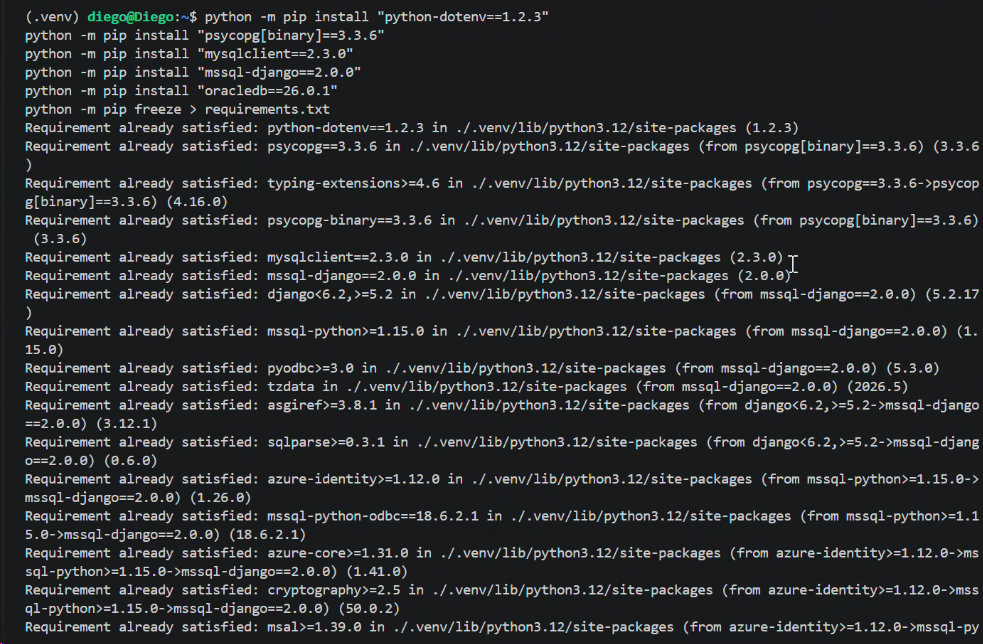

## Configuración de la plantilla de variables de entorno

Creación de la plantilla de configuración segura (`.env.example`) para definir las llaves de seguridad de Django, los hosts permitidos, el selector dinámico del motor de base de datos (`DB_ENGINE`) y las credenciales centralizadas del servidor para los cuatro motores compatibles (MySQL, PostgreSQL, SQL Server y Oracle), evitando exponer datos sensibles en el control de versiones.

```         
cat > .env.example <<'EOF'
DJANGO_SECRET_KEY=
DJANGO_DEBUG=True
DJANGO_ALLOWED_HOSTS=localhost,127.0.0.1,testserver

DB_ENGINE=mysql

POSTGRES_DB=SuministroPro
POSTGRES_USER=admin
POSTGRES_PASSWORD=1234
POSTGRES_HOST=172.28.108.52
POSTGRES_PORT=5433

MYSQL_DB=SuministroPro
MYSQL_USER=admin
MYSQL_PASSWORD=1234
MYSQL_HOST=172.28.108.52
MYSQL_PORT=3306

MSSQL_DB=SuministroPro
MSSQL_USER=admin
MSSQL_PASSWORD=1234
MSSQL_HOST=172.28.108.52
MSSQL_PORT=1433

ORACLE_DB=SuministroPro
ORACLE_USER=admin
ORACLE_PASSWORD=1234
ORACLE_HOST=172.28.108.52
ORACLE_PORT=1521
ORACLE_SERVICE_NAME=

CORS_ALLOW_ALL_ORIGINS=True
EOF
cp .env.example .env
```

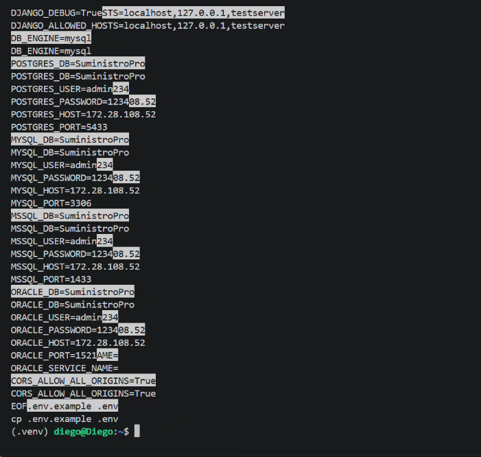

## Selección del motor MySQL en el archivo de entorno

Configuración del archivo de entorno local `.env` para fijar **MySQL** como el motor de base de datos activo en el proyecto, asociando las credenciales centralizadas del servidor `SuministroPro` con el puerto `3306`.

```         
sed -i 's/DB_ENGINE=.*/DB_ENGINE=mysql/' .env
sed -i 's/MYSQL_PORT=.*/MYSQL_PORT=3306/' .env
```

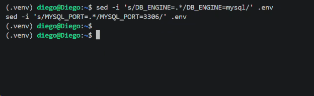

## Verificación de la variable del motor activo en el archivo de entorno

Comprobación mediante la herramienta `grep` en la terminal para confirmar que la variable `DB_ENGINE` en el archivo `.env` haya quedado asignada correctamente al motor de base de datos seleccionado (`mysql`).

```         
grep "DB_ENGINE" .env
```

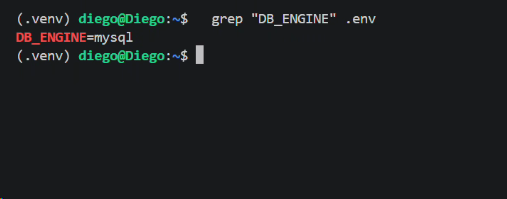

## Verificación del sistema y del motor activo con Django

Ejecución de la orden de comprobación del sistema mediante el ORM de Django para validar que la configuración del archivo de entorno y el motor de base de datos seleccionado respondan correctamente y sin incidencias.

```         
python manage.py check
```

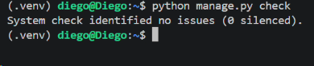

# ISS-02 — Apps.

## Creación de las aplicaciones del backend

Generación de la carpeta modular `apps` y creación de las seis aplicaciones de dominio (`client`, `supplier`, `product`, `purchase`, `sale`, `finance`) para mapear la totalidad del esquema relacional del sistema `SuministroPro`.

```         
mkdir -p apps/client apps/supplier apps/product apps/purchase apps/sale apps/finance
python manage.py startapp client apps/client
python manage.py startapp supplier apps/supplier
python manage.py startapp product apps/product
python manage.py startapp purchase apps/purchase
python manage.py startapp sale apps/sale
python manage.py startapp finance apps/finance
```

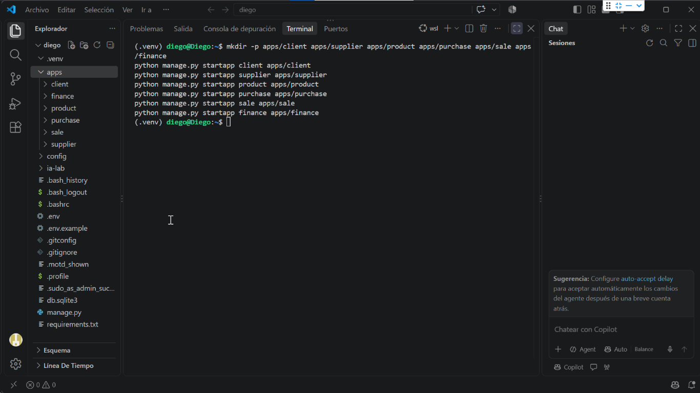

## Configuración de las rutas de importación en el archivo `apps.py`

Actualización del archivo de configuración de la aplicación `client` para reflejar su nueva ubicación dentro del paquete modular `apps`, especificando correctamente la ruta del módulo (`apps.client`) y su respectiva etiqueta de identificación (`label = "client"`), lo que previene conflictos de nombres en el registro global de Django.

## client

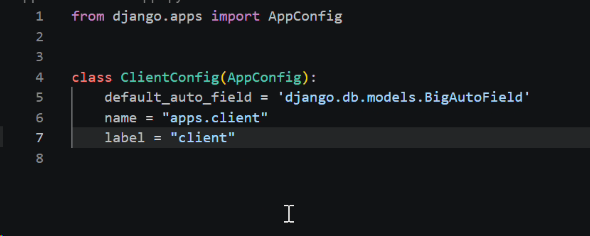

## finance

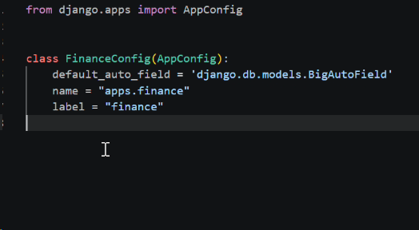

## product

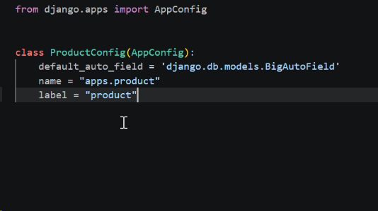

## purchase

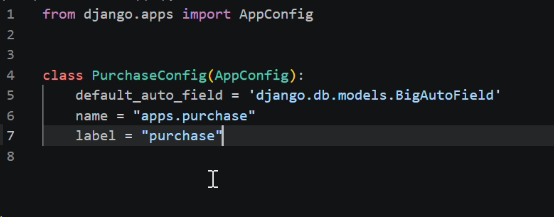

## sale

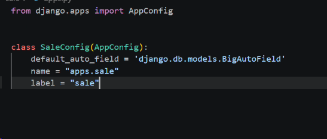

## supplier

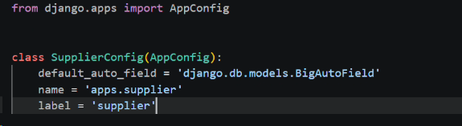

# Registro y centralización de las aplicaciones de dominio en `settings.py`

Inclusión explícita de las clases de configuración correspondientes a las aplicaciones creadas para estructurar el modelo relacional (`apps.client`, `apps.supplier`, `apps.product`, `apps.purchase`, `apps.sale` y `apps.finance`) dentro del arreglo `INSTALLED_APPS` del archivo de configuración global. Este paso establece la ruta oficial hacia donde se va a mover, mapear y gestionar todo el código fuente de los modelos de base de datos, asegurando que Django reconozca la arquitectura modular bajo el directorio `apps/`.

```         
ARCHIVO: config/settings/__init__.py

DEBAJO DE:
    "django.contrib.staticfiles",

AGREGAR:
    "apps.client.apps.ClientConfig",
    "apps.supplier.apps.SupplierConfig",
    "apps.product.apps.ProductConfig",
    "apps.purchase.apps.PurchaseConfig",
    "apps.sale.apps.SaleConfig",
    "apps.finance.apps.FinanceConfig",
```

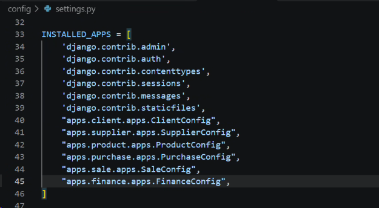

## Verificación de la carga de aplicaciones modulares (`ISS-02`)

Ejecución del comando de comprobación general de Django para certificar que las seis aplicaciones registradas (`client`, `supplier`, `product`, `purchase`, `sale` y `finance`) fueron correctamente reconocidas por el framework sin generar errores de importación, problemas de rutas o dependencias no resueltas.

```         
python manage.py check
```

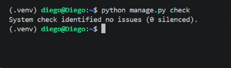

# ISS-03 — Custom User antes de la primera migración

## Creación del módulo común y definición de los estados de registro (`RecordStatus`)

Creación de la aplicación compartida `common` e implementación de la clase de opciones enumeradas `RecordStatus` mediante `models.TextChoices`, estableciendo un estándar global e inmutable para el manejo del estado lógico de los registros (`active` e `inactive`) en toda la base de datos del backend.

```         
mkdir -p apps/common
cat > apps/common/__init__.py <<'EOF'
EOF
cat > apps/common/status.py <<'EOF'
from django.db import models


class RecordStatus(models.TextChoices):
    ACTIVE = "active", "Active"
    INACTIVE = "inactive", "Inactive"
EOF
```

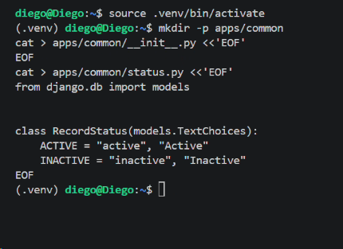

## Creación e inicialización del módulo de seguridad (`security`)

Creación del directorio de destino `apps/security` e inicialización de la aplicación de Django encargada de la autenticación, autorización y gestión de usuarios del sistema, garantizando la estructura modular necesaria antes de implementar el modelo de usuario personalizado (`Custom User`).

```         
mkdir -p apps/security
python manage.py startapp security apps/security
```

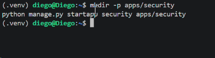

## Configuración de las rutas de importación en `apps.py` para el módulo de seguridad

Actualización de los parámetros de configuración de la clase `SecurityConfig` dentro de la aplicación `security`, especificando la ruta absoluta del paquete (`apps.security`) y su correspondiente etiqueta de identificación (`label = "security"`). Esto permite que el sistema mantenga la coherencia en la arquitectura modular y evite conflictos de espacios de nombres al registrar el modelo de usuario personalizado.

```         
ARCHIVO: apps/security/apps.py

UBICAR:
    name = "security"

REEMPLAZAR POR:
    name = "apps.security"
    label = "security"
```

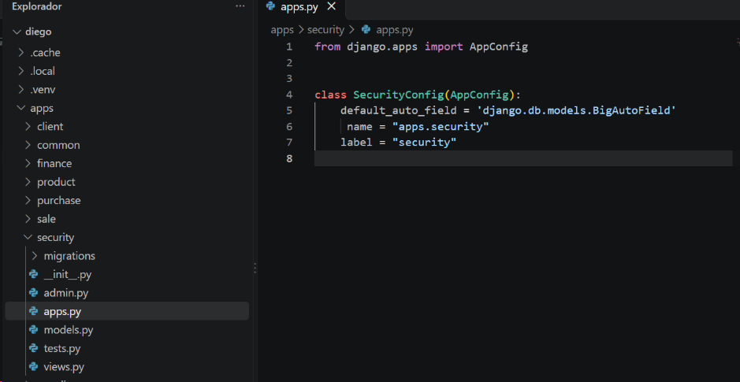

## Implementación del modelo de usuario personalizado (`User`) y su gestor (`StoreUserManager`)

Creación y definición del modelo de usuario personalizado en el archivo `apps/security/models.py`, heredando de `AbstractUser` para extender las funcionalidades nativas de autenticación de Django. Se integra el gestor personalizado `StoreUserManager` para automatizar la asignación del estado inicial (`INACTIVE` para usuarios estándar y `ACTIVE` para superusuarios), se ajusta el campo de correo electrónico para asegurar unicidad y normalización, y se configuran restricciones de validación a nivel de base de datos junto con la sincronización automática del campo booleano `is_active`.

```         
cat > apps/security/models.py <<'EOF'
from django.contrib.auth.models import AbstractUser, UserManager
from django.db import models

from apps.common.status import RecordStatus


class StoreUserManager(UserManager):
    def create_user(self, username, email=None, password=None, **extra_fields):
        extra_fields.setdefault("status", RecordStatus.INACTIVE)
        return super().create_user(username, email, password, **extra_fields)

    def create_superuser(self, username, email=None, password=None, **extra_fields):
        extra_fields.setdefault("status", RecordStatus.ACTIVE)
        extra_fields.setdefault("is_staff", True)
        extra_fields.setdefault("is_superuser", True)
        return super().create_superuser(username, email, password, **extra_fields)


class User(AbstractUser):
    email = models.EmailField("correo electrónico", max_length=150, unique=True)
    status = models.CharField(
        max_length=8,
        choices=RecordStatus.choices,
        default=RecordStatus.INACTIVE,
    )
    created_at = models.DateTimeField(auto_now_add=True)
    updated_at = models.DateTimeField(auto_now=True)

    objects = StoreUserManager()

    class Meta:
        db_table = "users"
        verbose_name = "usuario"
        verbose_name_plural = "usuarios"
        constraints = [
            models.CheckConstraint(
                condition=models.Q(status__in=RecordStatus.values),
                name="users_status_valid",
            )
        ]

    def save(self, *args, **kwargs):
        if self.email:
            self.email = self.email.strip().lower()
        self.is_active = self.status == RecordStatus.ACTIVE
        super().save(*args, **kwargs)
EOF
```

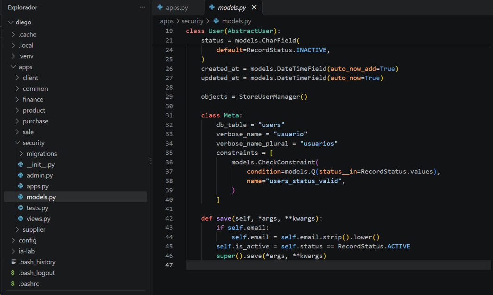

## Registro del módulo de seguridad y configuración del modelo de usuario personalizado (`AUTH_USER_MODEL`)

Inclusión formal de la aplicación `apps.security.apps.SecurityConfig` dentro del arreglo de aplicaciones instaladas (`INSTALLED_APPS`) y establecimiento de la directiva `AUTH_USER_MODEL = "security.User"` en la configuración principal. Esta configuración global le indica a Django que reemplace el modelo de usuario por defecto del framework por el modelo personalizado implementado, asegurando que todas las relaciones, autenticaciones y migraciones del sistema operen bajo la estructura definida en el módulo de seguridad.

```         
ARCHIVO: config/settings/__init__.py

ENCIMA DE:
    "apps.client.apps.ClientConfig",

AGREGAR:
    "apps.security.apps.SecurityConfig",

DEBAJO DE:
DATABASES = database_from_environ(os.environ)

AGREGAR:

AUTH_USER_MODEL = "security.User"
```

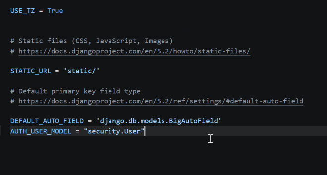](images/clipboard-2728258871.png)

## Implementación de pruebas unitarias para la selección dinámica de motores de base de datos (`tests.py`)

Creación y configuración del conjunto de pruebas automatizadas en `apps/security/tests.py` utilizando `SimpleTestCase` para validar el comportamiento del selector de bases de datos (`database_from_environ`). Se verifica la correcta asignación de motores para PostgreSQL, MySQL (con su respectivo juego de caracteres `utf8mb4`), MSSQL y Oracle (asegurando el uso correcto del `SERVICE_NAME`), así como el manejo de excepciones ante configuraciones inválidas o variables de entorno faltantes.

```         
ARCHIVO: apps/security/tests.py
remplazar y pegar todo el codigo 

from django.core.exceptions import ImproperlyConfigured
from django.test import SimpleTestCase

from config.database import database_from_environ


class DatabaseSelectionTests(SimpleTestCase):
    def _env(self, engine):
        return {
            "DB_ENGINE": engine,
            "POSTGRES_DB": "SuministroPro",
            "POSTGRES_USER": "admin",
            "POSTGRES_PASSWORD": "1234",
            "POSTGRES_HOST": "172.28.108.52",
            "POSTGRES_PORT": "5433",
            "MYSQL_DB": "SuministroPro",
            "MYSQL_USER": "admin",
            "MYSQL_PASSWORD": "1234",
            "MYSQL_HOST": "172.28.108.52",
            "MYSQL_PORT": "3306",
            "MSSQL_DB": "SuministroPro",
            "MSSQL_USER": "admin",
            "MSSQL_PASSWORD": "1234",
            "MSSQL_HOST": "172.28.108.52",
            "MSSQL_PORT": "1433",
            "ORACLE_DB": "SuministroPro",
            "ORACLE_USER": "admin",
            "ORACLE_PASSWORD": "1234",
            "ORACLE_HOST": "172.28.108.52",
            "ORACLE_PORT": "1521",
            "ORACLE_SERVICE_NAME": "FREEPDB1",
        }

    def test_postgresql_engine(self):
        config = database_from_environ(self._env("postgresql"))
        self.assertEqual(config["default"]["ENGINE"], "django.db.backends.postgresql")

    def test_mysql_engine(self):
        config = database_from_environ(self._env("mysql"))
        self.assertEqual(config["default"]["ENGINE"], "django.db.backends.mysql")
        self.assertEqual(config["default"]["OPTIONS"]["charset"], "utf8mb4")

    def test_mssql_engine(self):
        config = database_from_environ(self._env("mssql"))
        self.assertEqual(config["default"]["ENGINE"], "mssql")

    def test_oracle_uses_service_name(self):
        config = database_from_environ(self._env("oracle"))
        self.assertIn("SERVICE_NAME=FREEPDB1", config["default"]["NAME"])
        self.assertEqual(config["default"]["PORT"], "")

    def test_invalid_engine(self):
        with self.assertRaises(ImproperlyConfigured):
            database_from_environ({"DB_ENGINE": "sqlite"})

    def test_missing_variable(self):
        env = self._env("postgresql")
        env["POSTGRES_DB"] = ""
        with self.assertRaises(ImproperlyConfigured):
            database_from_environ(env)
```

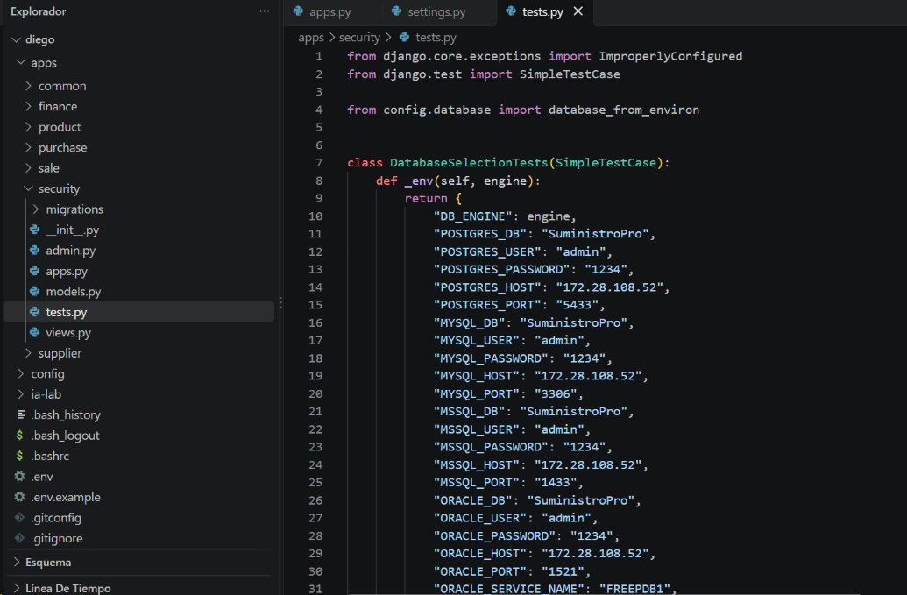

## Generación y aplicación de migraciones del módulo de seguridad y ejecución de pruebas unitarias de bases de datos

Creación de los archivos de migración específicos para la aplicación `security` (`makemigrations security`) y su posterior aplicación sobre la base de datos con el comando `migrate`, garantizando la sincronización del modelo de usuario personalizado. Finalmente, se ejecutaron las pruebas unitarias automatizadas (`python manage.py test apps.security.tests.DatabaseSelectionTests`) para validar la correcta resolución de los motores de bases de datos (PostgreSQL, MySQL, MSSQL y Oracle) utilizando los parámetros configurados en el entorno.

```         
python manage.py makemigrations security
python manage.py migrate
python manage.py test apps.security.tests.DatabaseSelectionTests
```

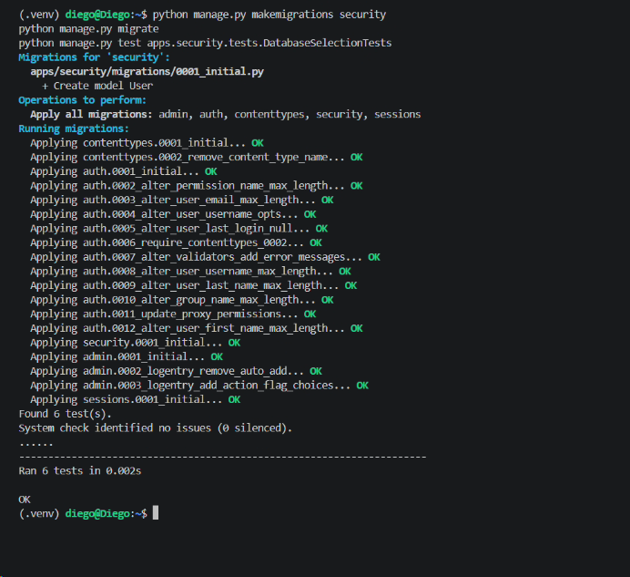

# ISS-04 — Modelo

## Definición de modelos base abstractos reutilizables en el módulo común (`apps/common/models.py`)

Se implementó la arquitectura de modelos abstractos dentro de `apps/common/models.py` para estandarizar la persistencia de datos en todo el proyecto. Se creó la clase `TimeStampedModel` para gestionar de forma automática los campos de auditoría temporal (`created_at` y `updated_at`), y la clase `StoreLabModel`, que extiende la anterior para añadir el control de estado del registro (`status`) mapeado con `RecordStatus` (estableciendo `INACTIVE` por defecto). Adicionalmente, se incluyó el método de clase `status_constraint` para reutilizar la definición de restricciones de verificación (`CheckConstraint`) a nivel de base de datos en los modelos derivados.

```         
cat > apps/common/models.py <<'EOF'
from django.db import models

from apps.common.status import RecordStatus


class TimeStampedModel(models.Model):
    created_at = models.DateTimeField(auto_now_add=True)
    updated_at = models.DateTimeField(auto_now=True)

    class Meta:
        abstract = True


class StoreLabModel(TimeStampedModel):
    status = models.CharField(
        max_length=8,
        choices=RecordStatus.choices,
        default=RecordStatus.INACTIVE,
    )

    class Meta:
        abstract = True

    @classmethod
    def status_constraint(cls, name):
        return models.CheckConstraint(
            condition=models.Q(status__in=RecordStatus.values),
            name=name,
        )
EOF
```

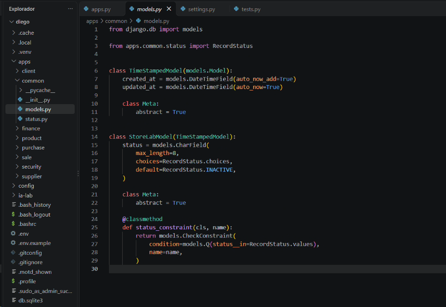

## Implementación del modelo de entidad Cliente (`Client`) en el módulo de ventas/clientes (`apps/client/models.py`)

Se definió el modelo de entidad `Client` heredando de la clase base abstracta `StoreLabModel`, integrando campos para la captura de información del cliente como nombre (`name`), dirección (`address`), teléfono (`phone`) y correo electrónico (`email`). Se configuró la tabla correspondiente en la base de datos (`clients`), añadiendo validadores de longitud mínima en el nombre y una restricción única en el correo. Asimismo, se sobrescribió el método `save` para realizar la normalización automática del email en minúsculas y sin espacios antes de la persistencia, y se asoció la restricción de validación de estado (`clients_status_valid`) heredada del modelo base.

```         
cat > apps/client/models.py <<'EOF'
from django.core.validators import MinLengthValidator
from django.db import models

from apps.common.models import StoreLabModel


class Client(StoreLabModel):
    name = models.CharField(max_length=150, validators=[MinLengthValidator(2)])
    address = models.CharField(max_length=255, null=True, blank=True)
    phone = models.CharField(max_length=30, null=True, blank=True)
    email = models.EmailField(max_length=150, null=True, blank=True, unique=True)

    class Meta:
        db_table = "clients"
        verbose_name = "cliente"
        verbose_name_plural = "clientes"
        ordering = ["name", "id"]
        constraints = [StoreLabModel.status_constraint("clients_status_valid")]

    def __str__(self):
        return self.name

    def save(self, *args, **kwargs):
        if self.email:
            self.email = self.email.strip().lower()
        super().save(*args, **kwargs)
EOF
```

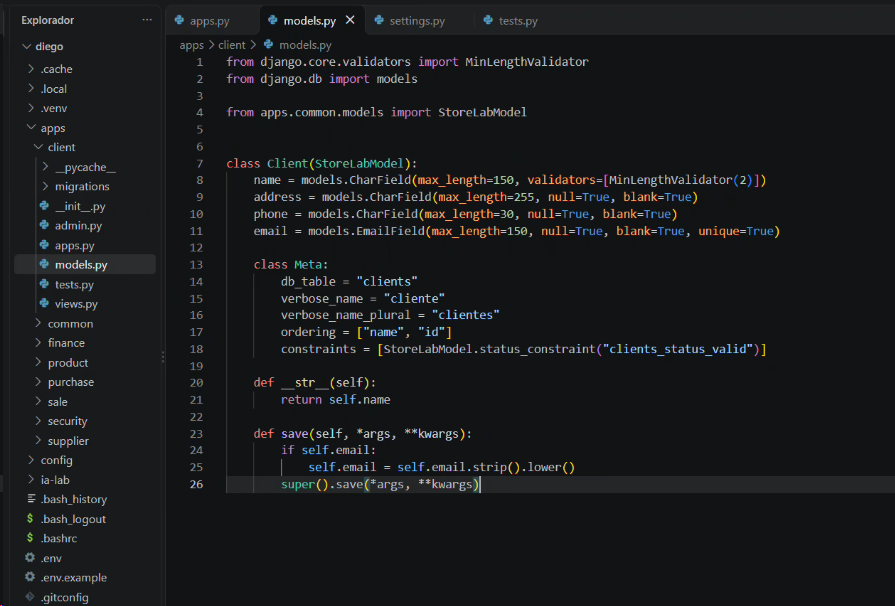

## Generación y aplicación de las migraciones del modelo `Client` en la base de datos

Se ejecutó el comando `python manage.py makemigrations client` para procesar la definición del modelo `Client` y generar la migración correspondiente (`0001_initial.py`). Posteriormente, se aplicó dicha migración en la base de datos **SuministroPro** mediante `python manage.py migrate`, lo que permitió la creación física de la tabla `clients` con todos sus campos, restricciones de estado (`clients_status_valid`), valores por defecto y claves primarias configuradas de acuerdo con la arquitectura base.

```         
python manage.py makemigrations client
python manage.py migrate
```

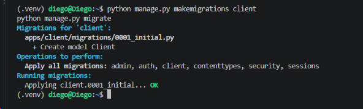

# ISS-05 — ProductType y Product

## Implementación de los modelos `Product` en el módulo de productos (`apps/product/models.py`)

Se implementaron los modelos de datos `ProductType` y `Product` dentro del módulo de productos (`apps/product/models.py`), extendiendo la clase base abstracta `StoreLabModel`. Para el modelo `ProductType`, se configuraron los campos de nombre y descripción con validadores de longitud mínima y unicidad. Para el modelo `Product`.

```         
ARCHIVO: apps/product/models.py

from decimal import Decimal

from django.core.validators import MinLengthValidator, MinValueValidator
from django.db import models

from apps.common.models import StoreLabModel


class Product(StoreLabModel):
    name = models.CharField(max_length=120, unique=True, validators=[MinLengthValidator(2)])
    product_type = models.CharField(max_length=100, null=True, blank=True)
    description = models.CharField(max_length=255, null=True, blank=True)
    price = models.DecimalField(
        max_digits=12,
        decimal_places=2,
        validators=[MinValueValidator(Decimal("0"))],
    )
    stock = models.PositiveIntegerField(default=0)

    class Meta:
        db_table = "products"
        verbose_name = "producto"
        verbose_name_plural = "productos"
        ordering = ["name", "id"]
        constraints = [
            StoreLabModel.status_constraint("products_status_valid"),
            models.CheckConstraint(
                condition=models.Q(price__gte=0),
                name="product_price_non_neg",
            ),
        ]

    def __str__(self):
        return self.name
```

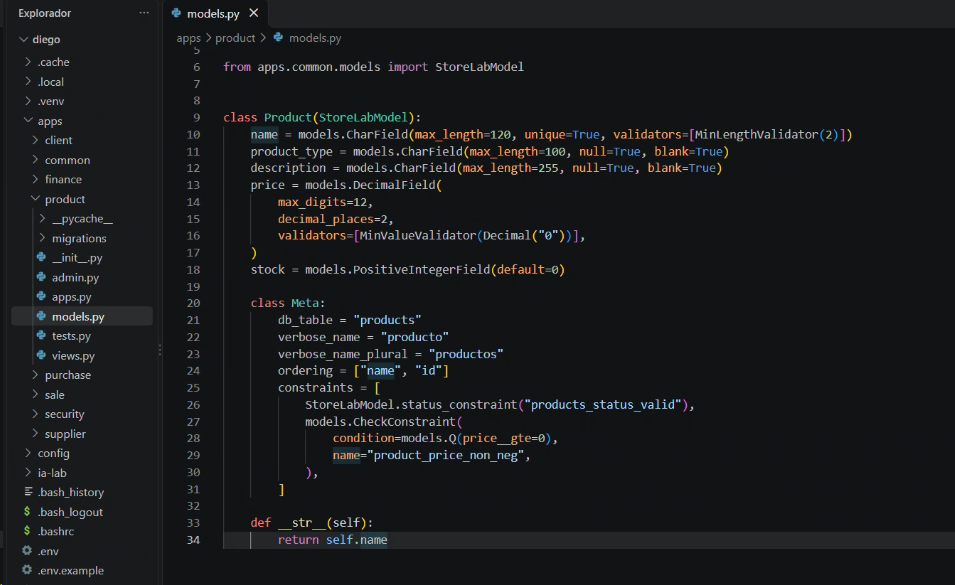

# ISS-06 — Sale y ProductSale

## Implementación del Custom Manager y QuerySet para el módulo de ventas (`apps/sale/managers.py`)

Se creó el módulo `managers.py` dentro de la aplicación de ventas (`apps/sale`), donde se definieron las clases `SaleQuerySet` y `SaleManager`. Estas clases extienden la funcionalidad base del ORM de Django (`models.QuerySet` y `models.Manager`), estableciendo la infraestructura necesaria para encapsular consultas personalizadas, filtros reutilizables y reglas de negocio específicas del dominio de ventas sin recargar la capa de modelos

```         
cat > apps/sale/managers.py <<'EOF'
from django.db import models


class SaleQuerySet(models.QuerySet):
    pass


class SaleManager(models.Manager.from_queryset(SaleQuerySet)):
    pass
EOF
```

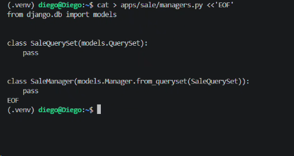

## Implementación de los modelos de dominio `Sale` y `ProductSale` en el módulo de ventas (`apps/sale/models.py`)

Se definieron las entidades relacionales `Sale` (cabecera de venta asociada al cliente) y `ProductSale` (detalle de productos que componen la venta) dentro del módulo `apps/sale/models.py`, heredando de la clase base abstracta `StoreLabModel`. En el modelo `Sale` se incorporaron campos para fecha de venta, montos calculados (subtotal, impuestos, descuentos y total), el gestor personalizado `SaleManager` y la lógica transaccional de anulación (`void`) para revertir el inventario de manera segura. En el modelo `ProductSale` se configuraron las relaciones de clave foránea con el producto y la venta, validadores de cantidad mínima, cálculos automáticos de subtotales por línea en el método `save`, y restricciones a nivel de base de datos (`CheckConstraint`) para asegurar la integridad de montos no negativos. Finalmente, se ejecutaron los comandos de migración y sincronización con la base de datos **SuministroPro**.

```         
cat > apps/sale/models.py <<'EOF'
from decimal import Decimal

from django.core.validators import MinValueValidator
from django.db import models, transaction

from apps.client.models import Client
from apps.common.models import StoreLabModel
from apps.common.status import RecordStatus
from apps.product.models import Product
from apps.sale.managers import SaleManager


class Sale(StoreLabModel):
    client = models.ForeignKey(
        Client,
        on_delete=models.RESTRICT,
        related_name="sales",
        db_column="client_id",
    )
    sale_date = models.DateTimeField()
    subtotal = models.DecimalField(max_digits=12, decimal_places=2, default=Decimal("0.00"))
    tax = models.DecimalField(max_digits=12, decimal_places=2, default=Decimal("0.00"))
    discounts = models.DecimalField(max_digits=12, decimal_places=2, default=Decimal("0.00"))
    total = models.DecimalField(max_digits=12, decimal_places=2, default=Decimal("0.00"))

    objects = SaleManager()

    class Meta:
        db_table = "sales"
        verbose_name = "venta"
        verbose_name_plural = "ventas"
        ordering = ["-sale_date", "-id"]
        constraints = [
            StoreLabModel.status_constraint("sales_status_valid"),
            models.CheckConstraint(
                condition=models.Q(subtotal__gte=0)
                & models.Q(tax__gte=0)
                & models.Q(discounts__gte=0)
                & models.Q(total__gte=0),
                name="sales_amounts_non_neg",
            ),
        ]

    def __str__(self):
        return f"Venta {self.pk}"

    def void(self):
        with transaction.atomic():
            sale = Sale.objects.select_for_update().get(pk=self.pk)
            if sale.status == RecordStatus.INACTIVE:
                return sale
            lines = sale.lines.select_related("product").select_for_update().order_by("product_id")
            for line in lines:
                if line.status != RecordStatus.ACTIVE:
                    continue
                product = Product.objects.select_for_update().get(pk=line.product_id)
                product.stock += line.quantity
                product.save(update_fields=["stock", "updated_at"])
                line.status = RecordStatus.INACTIVE
                line.save(update_fields=["status", "updated_at"])
            sale.status = RecordStatus.INACTIVE
            sale.save(update_fields=["status", "updated_at"])
            return sale


class ProductSale(StoreLabModel):
    sale = models.ForeignKey(
        Sale,
        on_delete=models.RESTRICT,
        related_name="lines",
        db_column="sale_id",
    )
    product = models.ForeignKey(
        Product,
        on_delete=models.RESTRICT,
        related_name="sale_lines",
        db_column="product_id",
    )
    quantity = models.PositiveIntegerField(validators=[MinValueValidator(1)])
    unit_price = models.DecimalField(max_digits=12, decimal_places=2)
    line_total = models.DecimalField(max_digits=12, decimal_places=2)

    class Meta:
        db_table = "product_sales"
        verbose_name = "detalle de venta"
        verbose_name_plural = "detalles de venta"
        ordering = ["id"]
        constraints = [
            StoreLabModel.status_constraint("product_sales_status_valid"),
            models.CheckConstraint(
                condition=models.Q(quantity__gte=1)
                & models.Q(unit_price__gte=0)
                & models.Q(line_total__gte=0),
                name="psale_amounts_valid",
            ),
        ]

    def __str__(self):
        return f"{self.product} x {self.quantity}"

    def save(self, *args, **kwargs):
        self.line_total = (self.unit_price * self.quantity).quantize(Decimal("0.01"))
        super().save(*args, **kwargs)
EOF
python manage.py makemigrations sale
python manage.py migrate
```

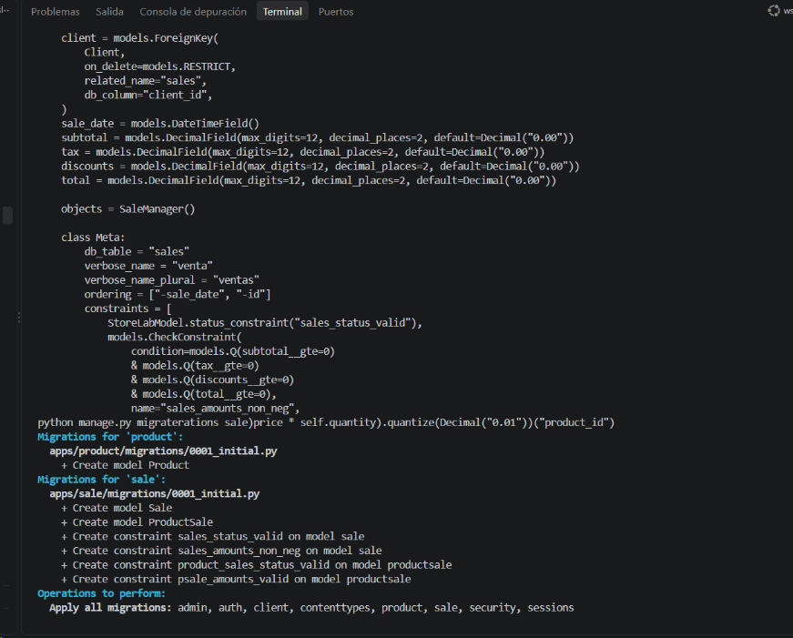

# ISS-07 — Serializers y JSON camelCase

## Instalación y configuración de dependencias para la API REST en el entorno virtual

Se activó el entorno virtual del proyecto y se instalaron las librerías esenciales para el desarrollo del ecosistema de API RESTful bajo los estándares establecidos: **Django REST Framework** para la construcción de servicios web, **Django REST Framework Camel Case** para mantener la consistencia en el formato de nomenclatura JSON (camelCase), y **Django CORS Headers** para la gestión de políticas de origen cruzado. Finalmente, se actualizó el archivo de dependencias del proyecto (`requirements.txt`) para asegurar la reproducibilidad del entorno de desarrollo.

```         
source .venv/bin/activate
python -m pip install "djangorestframework==3.17.2" "djangorestframework-camel-case==1.4.2" "django-cors-headers==4.9.0"
python -m pip freeze > requirements.txt
```

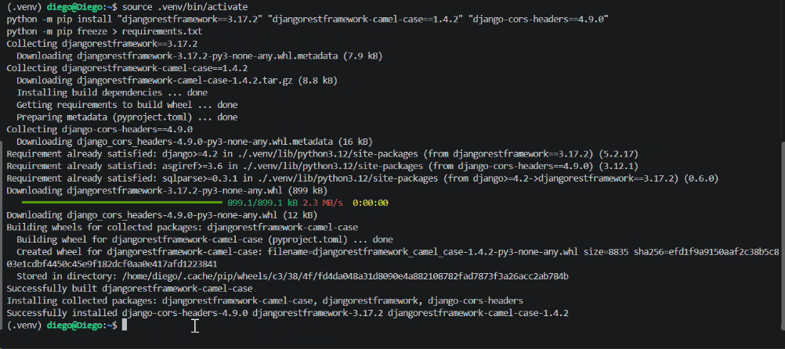

## Configuración de Django REST Framework, CORS y Camel Case en `config/settings/__init__.py`

Se actualizaron los ajustes de configuración global en `config/settings/__init__.py` para integrar las nuevas librerías del ecosistema de API. Se registraron las aplicaciones `rest_framework` y `corsheaders`, se configuró el middleware de CORS para permitir solicitudes de origen cruzado, y se establecieron los parámetros globales de **Django REST Framework** incluyendo la serialización en formato `camelCase` para los renderizadores y analizadores JSON, así como los permisos predeterminados.

```         
ARCHIVO: config/settings/__init__.py

ENCIMA DE:
    "apps.security.apps.SecurityConfig",

AGREGAR:
    "rest_framework",
    "corsheaders",

ENCIMA DE:
    "django.middleware.security.SecurityMiddleware",

AGREGAR:
    "corsheaders.middleware.CorsMiddleware",

DEBAJO DE:
DEFAULT_AUTO_FIELD = "django.db.models.BigAutoField"

AGREGAR:

CORS_ALLOW_ALL_ORIGINS = os.environ.get("CORS_ALLOW_ALL_ORIGINS", "True").strip().lower() in {
    "1",
    "true",
    "yes",
    "on",
}

REST_FRAMEWORK = {
    "DEFAULT_PERMISSION_CLASSES": [
        "rest_framework.permissions.AllowAny",
    ],
    "DEFAULT_RENDERER_CLASSES": [
        "djangorestframework_camel_case.render.CamelCaseJSONRenderer",
        "djangorestframework_camel_case.render.CamelCaseBrowsableAPIRenderer",
    ],
    "DEFAULT_PARSER_CLASSES": [
        "djangorestframework_camel_case.parser.CamelCaseJSONParser",
        "djangorestframework_camel_case.parser.CamelCaseFormParser",
        "djangorestframework_camel_case.parser.CamelCaseMultiPartParser",
    ],
    "DEFAULT_PAGINATION_CLASS": None,
}
```

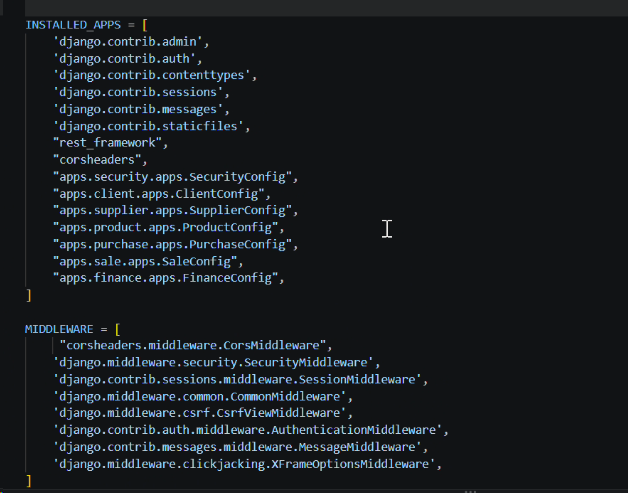

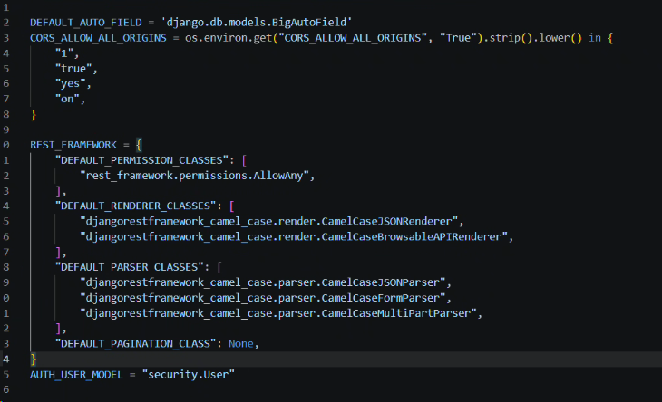

## Implementación del Serializador para el módulo de clientes (`apps/client/serializers.py`)

Se creó el archivo `serializers.py` dentro de la aplicación `apps/client` utilizando Django REST Framework para serializar y deserializar las instancias del modelo `Client`. Se configuraron los campos expuestos, campos de solo lectura (`id`, `created_at`, `updated_at`), validaciones personalizadas de longitud y formato de campos opcionales, así como la normalización del correo electrónico en minúsculas y el manejo de cadenas vacías como valores nulos.

```         
cat > apps/client/serializers.py <<'EOF'
from rest_framework import serializers

from apps.client.models import Client


class ClientSerializer(serializers.ModelSerializer):
    class Meta:
        model = Client
        fields = [
            "id",
            "name",
            "address",
            "phone",
            "email",
            "status",
            "created_at",
            "updated_at",
        ]
        read_only_fields = ["id", "created_at", "updated_at"]
        extra_kwargs = {
            "name": {"min_length": 2, "max_length": 150},
            "email": {"required": False, "allow_null": True, "allow_blank": True},
            "address": {"required": False, "allow_null": True, "allow_blank": True},
            "phone": {"required": False, "allow_null": True, "allow_blank": True},
        }

    def validate_email(self, value):
        if value is None or str(value).strip() == "":
            return None
        return value.strip().lower()

    def validate(self, attrs):
        for field in ("address", "phone"):
            if attrs.get(field) == "":
                attrs[field] = None
        return attrs
EOF
```

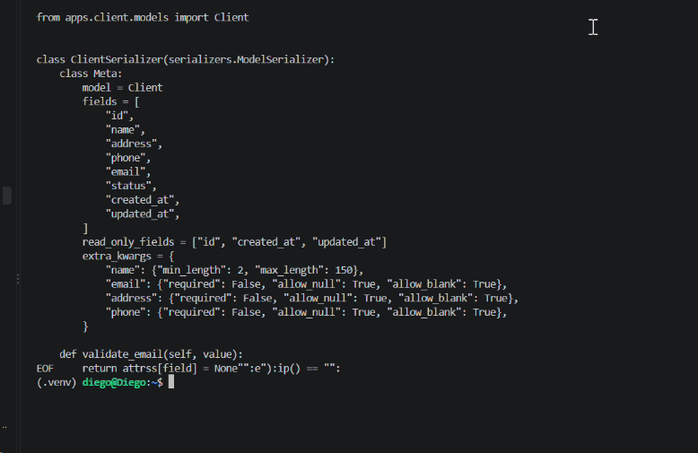

## Implementación de los serializadores para el módulo de productos y tipos de producto (`apps/product/serializers.py`)

Se crearon los serializadores `ProductTypeSerializer` y `ProductSerializer` dentro de la aplicación `apps/product` utilizando Django REST Framework. El primer serializador gestiona la conversión de los tipos de producto validando restricciones de longitud y normalizando descripciones vacías a valores nulos. El segundo serializador mapea la entidad `Product`, exponiendo una clave foránea interactiva (`product_type_id`) junto con el nombre del tipo de producto como campo de solo lectura (`product_type_name`), además de incorporar reglas de validación para nombres, descripciones y control de precios y existencias.

```         
cat > apps/product/serializers.py <<'EOF'
from rest_framework import serializers

from apps.product.models import Product, ProductType


class ProductTypeSerializer(serializers.ModelSerializer):
    class Meta:
        model = ProductType
        fields = ["id", "name", "description", "status", "created_at", "updated_at"]
        read_only_fields = ["id", "created_at", "updated_at"]
        extra_kwargs = {
            "name": {"min_length": 2, "max_length": 100},
            "description": {"required": False, "allow_null": True, "allow_blank": True},
        }

    def validate_description(self, value):
        if value is None or str(value).strip() == "":
            return None
        return value


class ProductSerializer(serializers.ModelSerializer):
    product_type_id = serializers.PrimaryKeyRelatedField(
        source="product_type",
        queryset=ProductType.objects.all(),
    )
    product_type_name = serializers.CharField(source="product_type.name", read_only=True)

    class Meta:
        model = Product
        fields = [
            "id",
            "product_type_id",
            "product_type_name",
            "name",
            "description",
            "price",
            "stock",
            "status",
            "created_at",
            "updated_at",
        ]
        read_only_fields = ["id", "product_type_name", "created_at", "updated_at"]
        extra_kwargs = {
            "name": {"min_length": 2, "max_length": 120},
            "description": {"required": False, "allow_null": True, "allow_blank": True},
        }

    def validate_description(self, value):
        if value is None or str(value).strip() == "":
            return None
        return value
EOF
```

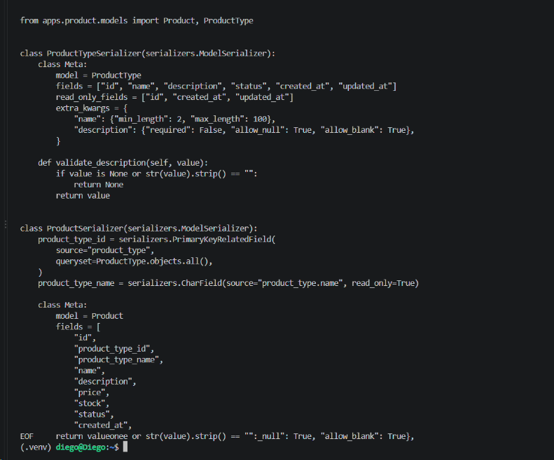

## Implementación de los serializadores para el dominio de ventas y detalle de productos (`apps/sale/serializers.py`)

Se crearon los serializadores `ProductSaleSerializer` y `SaleSerializer` dentro de la aplicación `apps/sale` utilizando Django REST Framework. El serializador de líneas de venta gestiona la representación de los productos asociados y sus cálculos financieros como campos de solo lectura, mientras que el serializador de cabecera de ventas expone los datos principales junto con el nombre del cliente (`client_name`) y la relación anidada de sus líneas de detalle (`lines`).

```         
cat > apps/sale/serializers.py <<'EOF'
from rest_framework import serializers

from apps.sale.models import ProductSale, Sale


class ProductSaleSerializer(serializers.ModelSerializer):
    product_name = serializers.CharField(source="product.name", read_only=True)

    class Meta:
        model = ProductSale
        fields = [
            "id",
            "product",
            "product_name",
            "quantity",
            "unit_price",
            "line_total",
            "status",
            "created_at",
            "updated_at",
        ]
        read_only_fields = fields


class SaleSerializer(serializers.ModelSerializer):
    client_name = serializers.CharField(source="client.name", read_only=True)
    lines = ProductSaleSerializer(many=True, read_only=True)

    class Meta:
        model = Sale
        fields = [
            "id",
            "client",
            "client_name",
            "sale_date",
            "subtotal",
            "tax",
            "discounts",
            "total",
            "status",
            "lines",
            "created_at",
            "updated_at",
        ]
        read_only_fields = fields
EOF
```

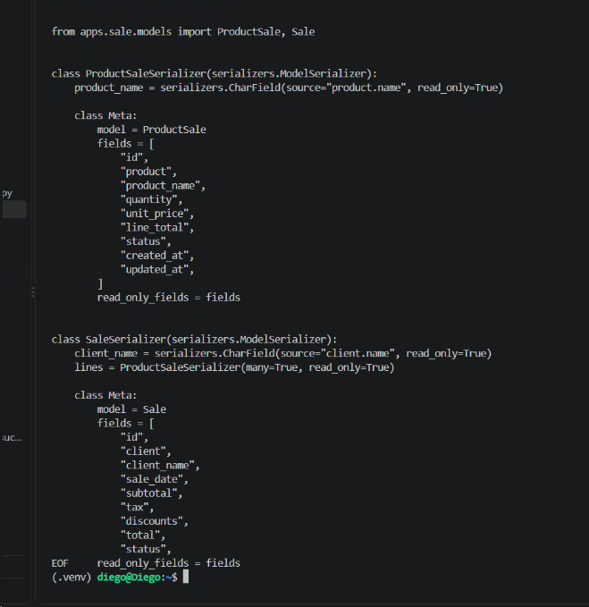

# ISS-08 — Client con ModelViewSet

## Implementación del ViewSet para el módulo de clientes (`apps/client/views.py`)

Se implementó el `ClientViewSet` dentro de la aplicación `apps/client` utilizando las vistas basadas en modelos de Django REST Framework (`viewsets.ModelViewSet`). Se configuró el conjunto de datos base, el serializador correspondiente y los permisos abiertos (`AllowAny`), junto con un filtro por parámetros de consulta para el estado (`status`) y una sobreescritura del método de eliminación (`perform_destroy`) para realizar una desactivación lógica (*soft delete*) en lugar de un borrado físico en la base de datos **SuministroPro**.

```         
cat > apps/client/views.py <<'EOF'
from rest_framework import viewsets
from rest_framework.permissions import AllowAny

from apps.client.models import Client
from apps.client.serializers import ClientSerializer
from apps.common.status import RecordStatus


class ClientViewSet(viewsets.ModelViewSet):
    queryset = Client.objects.all()
    serializer_class = ClientSerializer
    permission_classes = [AllowAny]
    lookup_value_converter = "int"

    def get_queryset(self):
        queryset = super().get_queryset()
        status_value = self.request.query_params.get("status")
        if status_value:
            queryset = queryset.filter(status=status_value)
        return queryset

    def perform_destroy(self, instance):
        instance.status = RecordStatus.INACTIVE
        instance.save(update_fields=["status", "updated_at"])
EOF
```

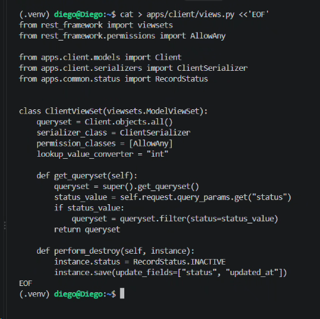

## Implementación de las pruebas automatizadas para la API de clientes (`apps/client/tests.py`)

Se implementó la suite de pruebas unitarias y de integración `ClientApiTests` utilizando `APITestCase` de Django REST Framework en el archivo `apps/client/tests.py`. Estas pruebas validan de forma integral el comportamiento del servicio REST de clientes, cubriendo la creación de registros con normalización de correos y persistencia, la validación de campos obligatorios y restricciones de unicidad, la ejecución de la eliminación lógica (*soft delete*) manteniendo la fila en la base de datos, así como las operaciones de listado, consulta de detalle y actualización parcial (`PATCH`).

```         
cat > apps/client/tests.py <<'EOF'
import json

from rest_framework import status
from rest_framework.test import APITestCase

from apps.client.models import Client
from apps.common.status import RecordStatus


class ClientApiTests(APITestCase):
    def test_create_defaults_and_persists(self):
        response = self.client.post(
            "/api/clients/",
            {"name": "María García", "email": "Maria@Example.com", "phone": "3001234567"},
            format="json",
        )
        self.assertEqual(response.status_code, status.HTTP_201_CREATED)
        self.assertEqual(response.data["status"], RecordStatus.INACTIVE)
        self.assertEqual(response.data["email"], "maria@example.com")
        wire = json.loads(response.content)
        self.assertIn("createdAt", wire)
        self.assertNotIn("created_at", wire)
        stored = Client.objects.get(pk=response.data["id"])
        self.assertEqual(stored.name, "María García")

    def test_invalid_name_and_duplicate_email(self):
        invalid = self.client.post("/api/clients/", {"name": "A"}, format="json")
        self.assertEqual(invalid.status_code, status.HTTP_400_BAD_REQUEST)
        self.client.post(
            "/api/clients/",
            {"name": "Ana Ruiz", "email": "ana@example.com"},
            format="json",
        )
        duplicate = self.client.post(
            "/api/clients/",
            {"name": "Otra Ana", "email": "ana@example.com"},
            format="json",
        )
        self.assertEqual(duplicate.status_code, status.HTTP_400_BAD_REQUEST)

    def test_soft_delete_keeps_the_row(self):
        created = self.client.post("/api/clients/", {"name": "Pedro León"}, format="json")
        deleted = self.client.delete(f"/api/clients/{created.data['id']}/")
        self.assertEqual(deleted.status_code, status.HTTP_204_NO_CONTENT)
        stored = Client.objects.get(pk=created.data["id"])
        self.assertEqual(stored.status, RecordStatus.INACTIVE)
        self.assertEqual(Client.objects.count(), 1)

    def test_list_retrieve_and_update(self):
        created = self.client.post(
            "/api/clients/",
            {"name": "Luisa Mora", "phone": "111"},
            format="json",
        )
        pk = created.data["id"]
        listed = self.client.get("/api/clients/")
        self.assertEqual(listed.status_code, status.HTTP_200_OK)
        detail = self.client.get(f"/api/clients/{pk}/")
        self.assertEqual(detail.status_code, status.HTTP_200_OK)
        self.assertEqual(detail.data["name"], "Luisa Mora")
        updated = self.client.patch(
            f"/api/clients/{pk}/",
            {"phone": "222", "status": "active"},
            format="json",
        )
        self.assertEqual(updated.status_code, status.HTTP_200_OK)
        self.assertEqual(updated.data["status"], "active")
EOF
```

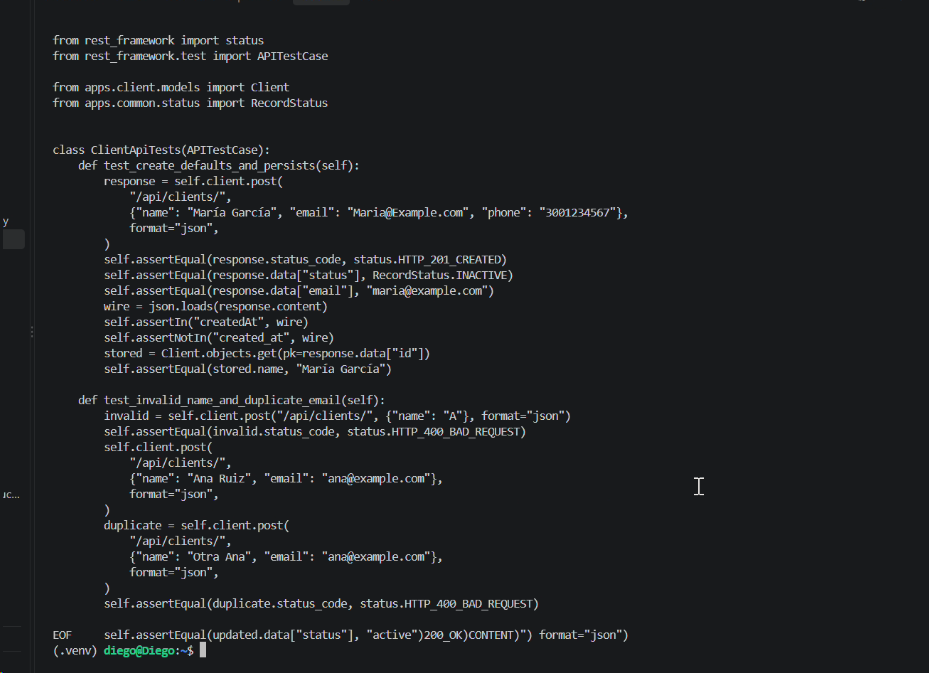

## Comando para la ejecución de pruebas del módulo de clientes

El comando `python manage.py test apps.client` se utiliza en Django para descubrir y ejecutar de forma automatizada todas las pruebas unitarias y de integración asociadas exclusivamente a la aplicación de clientes. Al invocarlo, el framework levanta una base de datos temporal, valida las reglas de negocio, los serializadores y los puntos de acceso de la API, y posteriormente limpia el entorno de pruebas, reportando el estado final de la ejecución.

```         
python manage.py test apps.client
```

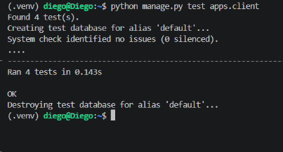

## Actualización del enrutador en `apps/client/urls.py` utilizando `SimpleRouter`

Se actualizó el archivo `apps/client/urls.py` para utilizar `SimpleRouter` de Django REST Framework en lugar de `DefaultRouter`, configurando el parámetro `use_regex_path=False` para optimizar el enrutamiento y registrar directamente las rutas del `ClientViewSet` bajo el prefijo `clients`.

```         
cat > apps/client/urls.py <<'EOF'
from rest_framework.routers import SimpleRouter

from apps.client.views import ClientViewSet

router = SimpleRouter(use_regex_path=False)
router.register("clients", ClientViewSet, basename="client")

urlpatterns = router.urls
EOF
```

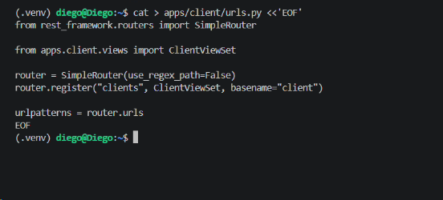

## Actualización del archivo de rutas principal del proyecto (`config/urls.py`)

Se modificó el archivo `config/urls.py` incorporando la importación de la función `include` junto con `path`, y se registró la ruta base de la API (`/api/`) para incluir el enrutador de la aplicación de clientes (`apps.client.urls`).

```         
ARCHIVO: config/urls.py

UBICAR:
from django.urls import path

REEMPLAZAR POR:
from django.urls import include, path

DEBAJO DE:
    path("admin/", admin.site.urls),

AGREGAR:
    path("api/", include("apps.client.urls")),
```

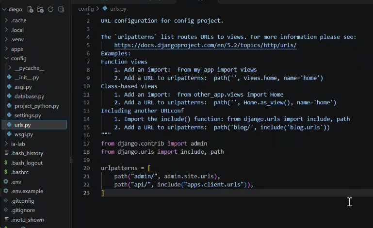

# ISS-09 — Catálogo con ModelViewSet

## Implementación de las vistas para el módulo de productos (`apps/product/views.py`)Implementación de las vistas para el módulo de productos (`apps/product/views.py`)

Se implementó el archivo `apps/product/views.py` definiendo una clase base reutilizable llamada `CatalogViewSet` que hereda de `viewsets.ModelViewSet`. Esta clase centraliza la lógica común para el filtrado por parámetros de consulta del estado (`status`) y la sobreescritura del método `perform_destroy` para aplicar la desactivación lógica (*soft delete*). A partir de esta base, se configuraron las vistas específicas `ProductTypeViewSet` y `ProductViewSet`, optimizando esta última con `select_related("product_type")` para garantizar una gestión eficiente y relacional de los productos dentro de la arquitectura del proyecto.

```         
cat > apps/product/views.py <<'EOF'
from rest_framework import viewsets
from rest_framework.permissions import AllowAny

from apps.common.status import RecordStatus
from apps.product.models import Product, ProductType
from apps.product.serializers import ProductSerializer, ProductTypeSerializer


class CatalogViewSet(viewsets.ModelViewSet):
    permission_classes = [AllowAny]
    lookup_value_converter = "int"

    def get_queryset(self):
        queryset = super().get_queryset()
        status_value = self.request.query_params.get("status")
        if status_value:
            queryset = queryset.filter(status=status_value)
        return queryset

    def perform_destroy(self, instance):
        instance.status = RecordStatus.INACTIVE
        instance.save(update_fields=["status", "updated_at"])


class ProductTypeViewSet(CatalogViewSet):
    queryset = ProductType.objects.all()
    serializer_class = ProductTypeSerializer


class ProductViewSet(CatalogViewSet):
    queryset = Product.objects.select_related("product_type")
    serializer_class = ProductSerializer
EOF
```

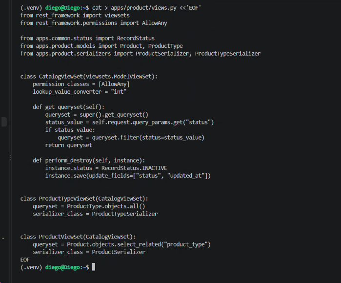

## Configuración de las rutas del módulo de productos (`apps/product/urls.py`)

Se creó el archivo `apps/product/urls.py` utilizando `SimpleRouter` con la configuración `use_regex_path=False`, registrando de manera limpia y estandarizada los puntos de acceso para los tipos de producto (`product-types`) y los productos (`products`) asociados a sus respectivos `ViewSets`.

```         
cat > apps/product/urls.py <<'EOF'
from rest_framework.routers import SimpleRouter

from apps.product.views import ProductTypeViewSet, ProductViewSet

router = SimpleRouter(use_regex_path=False)
router.register("product-types", ProductTypeViewSet, basename="product-type")
router.register("products", ProductViewSet, basename="product")

urlpatterns = router.urls
EOF
```

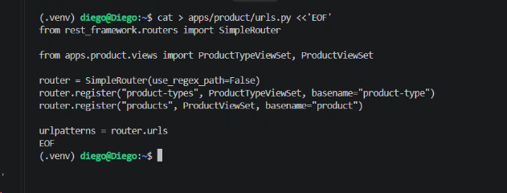

## Integración de las rutas del módulo de productos en el enrutador principal (`config/urls.py`)

Se actualizó el archivo de rutas principal del proyecto (`config/urls.py`) agregando la inclusión del archivo `apps.product.urls` bajo el prefijo común `/api/`, asegurando de este modo que los puntos de acceso para la gestión de productos y tipos de producto queden disponibles en la API del sistema.

```         
ARCHIVO: config/urls.py

DEBAJO DE:
    path("api/", include("apps.client.urls")),

AGREGAR:
    path("api/", include("apps.product.urls")),
```

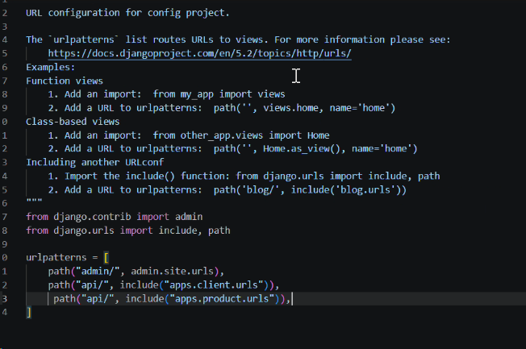

## Creación de las pruebas automatizadas para el módulo de productos (`apps/product/tests.py`)

Se implementó el archivo `apps/product/tests.py` incorporando pruebas de integración basadas en `APITestCase` para validar rigurosamente el funcionamiento de la API de productos y tipos de producto. Esto incluye la verificación de los endpoints CRUD, la correcta aplicación del borrado lógico (*soft delete*), la asignación de valores por defecto en el estado y stock, las restricciones de eliminación en cascada o restricción, y la validación de nombres duplicados para garantizar la integridad del dominio.

```         
cat > apps/product/tests.py <<'EOF'
from decimal import Decimal

from django.db.models.deletion import RestrictedError
from rest_framework.test import APITestCase

from apps.common.status import RecordStatus
from apps.product.models import Product, ProductType


class ProductApiTests(APITestCase):
    def setUp(self):
        self.product_type = ProductType.objects.create(name="Bebida", status=RecordStatus.ACTIVE)

    def test_product_type_crud(self):
        created = self.client.post(
            "/api/product-types/",
            {"name": "Lácteo", "description": "Fríos"},
            format="json",
        )
        self.assertEqual(created.status_code, 201)
        self.assertEqual(created.data["status"], RecordStatus.INACTIVE)
        pk = created.data["id"]
        self.assertEqual(self.client.get("/api/product-types/").status_code, 200)
        detail = self.client.get(f"/api/product-types/{pk}/")
        self.assertEqual(detail.data["name"], "Lácteo")
        updated = self.client.patch(
            f"/api/product-types/{pk}/",
            {"status": "active"},
            format="json",
        )
        self.assertEqual(updated.status_code, 200)
        deleted = self.client.delete(f"/api/product-types/{pk}/")
        self.assertEqual(deleted.status_code, 204)
        self.assertEqual(ProductType.objects.get(pk=pk).status, RecordStatus.INACTIVE)

    def test_product_retrieve_update_and_soft_delete(self):
        created = self.client.post(
            "/api/products/",
            {
                "productTypeId": self.product_type.id,
                "name": "Leche",
                "price": "3.20",
                "stock": 2,
                "status": "active",
            },
            format="json",
        )
        pk = created.data["id"]
        detail = self.client.get(f"/api/products/{pk}/")
        self.assertEqual(detail.status_code, 200)
        updated = self.client.patch(f"/api/products/{pk}/", {"stock": 9}, format="json")
        self.assertEqual(updated.status_code, 200)
        self.assertEqual(updated.data["stock"], 9)
        deleted = self.client.delete(f"/api/products/{pk}/")
        self.assertEqual(deleted.status_code, 204)
        self.assertEqual(Product.objects.get(pk=pk).status, RecordStatus.INACTIVE)

    def test_default_status_and_type_restriction(self):
        created = self.client.post(
            "/api/products/",
            {"productTypeId": self.product_type.id, "name": "Té", "price": "1.00"},
            format="json",
        )
        self.assertEqual(created.status_code, 201)
        self.assertEqual(created.data["status"], "inactive")
        self.assertEqual(created.data["stock"], 0)
        with self.assertRaises(RestrictedError):
            self.product_type.delete()

    def test_duplicate_product_name(self):
        payload = {"productTypeId": self.product_type.id, "name": "Café", "price": "3.00"}
        self.assertEqual(self.client.post("/api/products/", payload, format="json").status_code, 201)
        self.assertEqual(self.client.post("/api/products/", payload, format="json").status_code, 400)
        self.assertEqual(Product.objects.get(name="Café").price, Decimal("3.00"))
EOF
```

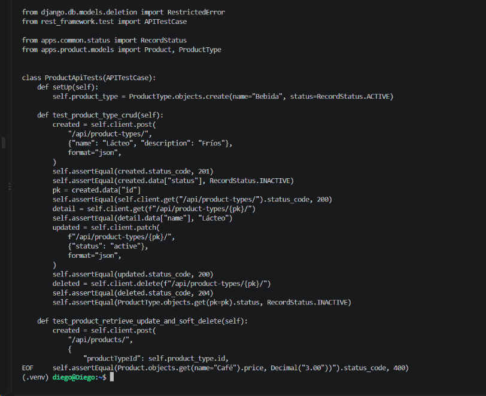

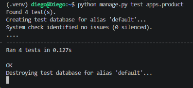

# ISS-10 — Disponibles con ListAPIView

## Actualización de las rutas en `apps/product/urls.py` para incluir la vista de productos disponibles

Se modificó el archivo `apps/product/urls.py` incorporando la importación de `path` desde `django.urls`, agregando la importación de la nueva vista `AvailableProductListAPIView` y configurando el patrón de URL específico `products/available/` antes de concatenar las rutas generadas por el enrutador (`router.urls`), asegurando que el nuevo punto de acceso quede disponible correctamente dentro de la API.

```         
ARCHIVO: apps/product/urls.py

UBICAR:
from rest_framework.routers import SimpleRouter

REEMPLAZAR POR:
from django.urls import path
from rest_framework.routers import SimpleRouter

UBICAR el import de las vistas y AGREGAR AvailableProductListAPIView.

REEMPLAZAR:
urlpatterns = router.urls

POR:
urlpatterns = [
    path(
        "products/available/",
        AvailableProductListAPIView.as_view(),
        name="product-available",
    ),
]
urlpatterns += router.urls
```

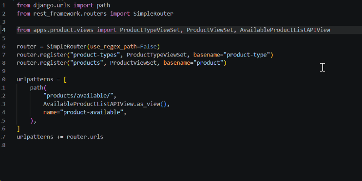

## Incorporación de la vista `AvailableProductListAPIView` en `apps/product/views.py`

Se actualizó el archivo `apps/product/views.py` importando `ListAPIView` desde `rest_framework.generics` e implementando la clase `AvailableProductListAPIView`. Esta vista permite listar de forma específica únicamente los productos activos que cuentan con stock disponible y cuyo tipo de producto también se encuentra activo (`status=RecordStatus.ACTIVE`, `stock__gt=0` y `product_type__status=RecordStatus.ACTIVE`), optimizando la consulta mediante `select_related("product_type")`.

```         
ARCHIVO: apps/product/views.py

ENCIMA DE:
from rest_framework import viewsets

AGREGAR, en la misma línea de imports de rest_framework si ya está viewsets:
from rest_framework.generics import ListAPIView

AL FINAL DEL ARCHIVO, AGREGAR:

class AvailableProductListAPIView(ListAPIView):
    permission_classes = [AllowAny]
    serializer_class = ProductSerializer

    def get_queryset(self):
        return Product.objects.select_related("product_type").filter(
            status=RecordStatus.ACTIVE,
            stock__gt=0,
            product_type__status=RecordStatus.ACTIVE,
        )
```

](images/clipboard-2192895866.png)

## Incorporación de la prueba de productos disponibles en `apps/product/tests.py`

Se actualizó el archivo `apps/product/tests.py` agregando el método de prueba `test_product_crud_and_available_filter` al final de la clase `ProductApiTests`. Esta prueba valida que al crear un producto con stock y estado activo, este aparezca correctamente en el endpoint específico `/api/products/available/`, y que al actualizar su stock a cero, la lista de productos disponibles devuelva un conjunto vacío como se espera.

```         
ARCHIVO: apps/product/tests.py

AL FINAL DE class ProductApiTests, AGREGAR:

    def test_product_crud_and_available_filter(self):
        created = self.client.post(
            "/api/products/",
            {
                "productTypeId": self.product_type.id,
                "name": "Agua",
                "price": "2.50",
                "stock": 4,
                "status": "active",
            },
            format="json",
        )
        self.assertEqual(created.status_code, 201)
        available = self.client.get("/api/products/available/")
        self.assertEqual(available.status_code, 200)
        self.assertEqual(len(available.data), 1)
        Product.objects.filter(pk=created.data["id"]).update(stock=0)
        empty = self.client.get("/api/products/available/")
        self.assertEqual(empty.data, [])
```

](images/clipboard-3263066772.png)

# ISS-11 — Registro de venta con APIView

## Implementación del gestor transaccional de ventas (`apps/sale/managers.py`)

Se ha actualizado el archivo `apps/sale/managers.py` incorporando toda la lógica de negocio y el control transaccional necesarios dentro de la clase `SaleQuerySet` a través del método `register`. Esto permite gestionar el registro integral de una venta validando la existencia de ítems, el control estricto de descuentos no negativos, el bloqueo concurrente con `select_for_update` para clientes y productos, la verificación de estados activos y stock suficiente, así como la actualización atómica del inventario y el cálculo preciso de subtotales y totales.

```         
ARCHIVO: apps/sale/managers.py

UBICAR:
from django.db import models

REEMPLAZAR POR:
from decimal import Decimal

from django.core.exceptions import ValidationError
from django.db import models, transaction

from apps.common.status import RecordStatus
from apps.product.models import Product

UBICAR:
class SaleQuerySet(models.QuerySet):
    pass

REEMPLAZAR POR:

class SaleQuerySet(models.QuerySet):
    def register(self, *, client, sale_date, items, discounts):
        if not items:
            raise ValidationError({"items": ["La venta requiere al menos un producto."]})
        discounts = Decimal(discounts).quantize(Decimal("0.01"))
        if discounts < 0:
            raise ValidationError({"discounts": ["El descuento no puede ser negativo."]})

        quantities = {}
        for item in items:
            quantity = int(item["quantity"])
            if quantity < 1:
                raise ValidationError({"items": ["La cantidad debe ser al menos 1."]})
            product_id = item["product_id"]
            quantities[product_id] = quantities.get(product_id, 0) + quantity

        with transaction.atomic():
            locked_client = client.__class__.objects.select_for_update().get(pk=client.pk)
            if locked_client.status != RecordStatus.ACTIVE:
                raise ValidationError({"client_id": ["El cliente debe estar active."]})

            locked_products = {
                product.id: product
                for product in Product.objects.select_for_update()
                .select_related("product_type")
                .filter(pk__in=quantities)
                .order_by("id")
            }
            if len(locked_products) != len(quantities):
                raise ValidationError({"items": ["Hay productos que no existen."]})

            for product_id, quantity in quantities.items():
                product = locked_products[product_id]
                if product.status != RecordStatus.ACTIVE:
                    raise ValidationError(
                        {"items": [f"El producto {product.name} no está active."]}
                    )
                if product.product_type.status != RecordStatus.ACTIVE:
                    raise ValidationError(
                        {"items": [f"El tipo de {product.name} no está active."]}
                    )
                if product.stock < quantity:
                    raise ValidationError(
                        {"items": [f"Stock insuficiente para {product.name}."]}
                    )

            sale = self.model(
                client=locked_client,
                sale_date=sale_date,
                subtotal=Decimal("0.00"),
                tax=Decimal("0.00"),
                discounts=discounts,
                total=Decimal("0.00"),
                status=RecordStatus.INACTIVE,
            )
            sale.save()

            subtotal = Decimal("0.00")
            for item in items:
                product = locked_products[item["product_id"]]
                unit_price = product.price
                quantity = int(item["quantity"])
                line_total = (unit_price * quantity).quantize(Decimal("0.01"))
                sale.lines.create(
                    product=product,
                    quantity=quantity,
                    unit_price=unit_price,
                    line_total=line_total,
                    status=RecordStatus.ACTIVE,
                )
                subtotal += line_total

            subtotal = subtotal.quantize(Decimal("0.01"))
            if discounts > subtotal:
                raise ValidationError(
                    {"discounts": ["El descuento no puede superar el subtotal."]}
                )
            tax = Decimal("0.00")
            total = (subtotal + tax - discounts).quantize(Decimal("0.01"))
            sale.subtotal = subtotal
            sale.tax = tax
            sale.discounts = discounts
            sale.total = total
            sale.status = RecordStatus.ACTIVE
            sale.save(
                update_fields=[
                    "subtotal",
                    "tax",
                    "discounts",
                    "total",
                    "status",
                    "updated_at",
                ]
            )

            for product_id, quantity in quantities.items():
                product = locked_products[product_id]
                product.stock -= quantity
                product.save(update_fields=["stock", "updated_at"])
            return sale
```


## Implementación de los serializadores para el registro de ventas (`apps/sale/serializers.py`)

Se ha actualizado el archivo `apps/sale/serializers.py` incorporando las clases `SaleItemSerializer` y `SaleRegisterSerializer`. Estas clases gestionan la validación de los datos de entrada (como la verificación de la existencia de clientes y productos mediante llaves primarias, cantidades mínimas y control de descuentos decimales), conectando directamente los datos validados con el método personalizado `Sale.objects.register` y transformando de manera adecuada las excepciones de validación de Django hacia el formato estándar de Django REST Framework.

```         
ARCHIVO: apps/sale/serializers.py

ENCIMA DE:
from rest_framework import serializers

AGREGAR:
from decimal import Decimal

from django.core.exceptions import ValidationError as DjangoValidationError

DEBAJO DE los imports existentes, AGREGAR:
from apps.client.models import Client
from apps.product.models import Product

AL FINAL DEL ARCHIVO, AGREGAR:

class SaleItemSerializer(serializers.Serializer):
    product_id = serializers.PrimaryKeyRelatedField(
        queryset=Product.objects.all(),
        source="product",
    )
    quantity = serializers.IntegerField(min_value=1)


class SaleRegisterSerializer(serializers.Serializer):
    client_id = serializers.PrimaryKeyRelatedField(
        queryset=Client.objects.all(),
        source="client",
    )
    sale_date = serializers.DateTimeField()
    discounts = serializers.DecimalField(
        max_digits=12,
        decimal_places=2,
        min_value=Decimal("0.00"),
        required=False,
        default=Decimal("0.00"),
    )
    items = SaleItemSerializer(many=True, allow_empty=False)

    def create(self, validated_data):
        items = [
            {"product_id": item["product"].id, "quantity": item["quantity"]}
            for item in validated_data["items"]
        ]
        try:
            return Sale.objects.register(
                client=validated_data["client"],
                sale_date=validated_data["sale_date"],
                discounts=validated_data["discounts"],
                items=items,
            )
        except DjangoValidationError as exc:
            if getattr(exc, "message_dict", None):
                raise serializers.ValidationError(exc.message_dict) from exc
            raise serializers.ValidationError(exc.messages) from exc
```


## Implementación de las vistas para el registro y gestión de ventas (`apps/sale/views.py`)

Se ha creado y configurado el archivo `apps/sale/views.py` incorporando las clases `SaleRegisterAPIView` y `SaleCollectionAPIView`. Estas vistas permiten procesar las solicitudes HTTP POST para registrar nuevas ventas mediante el serializador especializado, optimizando la consulta posterior con `prefetch_related` para incluir las líneas y productos asociados, y devolviendo la respuesta formateada con el código de estado HTTP 201 Created correspondiente.

```         
cat > apps/sale/views.py <<'EOF'
from rest_framework import status
from rest_framework.permissions import AllowAny
from rest_framework.response import Response
from rest_framework.views import APIView

from apps.sale.models import Sale
from apps.sale.serializers import SaleRegisterSerializer, SaleSerializer


class SaleRegisterAPIView(APIView):
    permission_classes = [AllowAny]

    def post(self, request):
        serializer = SaleRegisterSerializer(data=request.data)
        serializer.is_valid(raise_exception=True)
        sale = serializer.save()
        sale = Sale.objects.prefetch_related("lines__product").get(pk=sale.pk)
        return Response(SaleSerializer(sale).data, status=status.HTTP_201_CREATED)


class SaleCollectionAPIView(APIView):
    permission_classes = [AllowAny]

    def post(self, request, *args, **kwargs):
        handler = SaleRegisterAPIView()
        handler.request = request
        handler.format_kwarg = None
        handler.args = ()
        handler.kwargs = {}
        return handler.post(request)
EOF
```


## Configuración de las rutas del módulo de ventas (`apps/sale/urls.py`)

Se ha configurado el archivo `apps/sale/urls.py` estableciendo el patrón de URL para el punto de acceso de ventas (`sales/`), el cual enruta las solicitudes hacia `SaleCollectionAPIView` para permitir la gestión y registro de transacciones dentro de la API.

```         
cat > apps/sale/urls.py <<'EOF'
from django.urls import path

from apps.sale.views import SaleCollectionAPIView

urlpatterns = [
    path("sales/", SaleCollectionAPIView.as_view(), name="sale-collection"),
]
EOF
```


## Integración de las rutas de ventas en la configuración principal (`config/urls.py`)

Se ha actualizado el archivo `config/urls.py` incorporando el registro de rutas del módulo de ventas mediante `path("api/", include("apps.sale.urls"))`, ubicándolo de manera consecutiva justo debajo de las rutas de productos. Esto permite unificar todos los endpoints de la API bajo el prefijo común `/api/` en el proyecto de Tecnogua.

```         
ARCHIVO: config/urls.py

DEBAJO DE:
    path("api/", include("apps.product.urls")),

AGREGAR:
    path("api/", include("apps.sale.urls")),
```

 

## Implementación de la suite de pruebas transaccionales para ventas (`apps/sale/tests.py`)

Se ha creado y configurado el archivo `apps/sale/tests.py` implementando la clase de pruebas `SaleTransactionTests`. Esta suite valida de forma rigurosa el comportamiento transaccional del módulo de ventas, abarcando pruebas para el registro exitoso con cálculo de subtotales, descuentos y actualización de inventario, así como pruebas de reversión (*rollback*) ante stock insuficiente, fallos simulados en la base de datos o el uso de clientes con estado inactivo.

```         
cat > apps/sale/tests.py <<'EOF'
from decimal import Decimal
from unittest.mock import patch

from django.utils import timezone
from rest_framework.test import APITestCase

from apps.client.models import Client
from apps.common.status import RecordStatus
from apps.product.models import Product, ProductType
from apps.sale.models import ProductSale, Sale


class SaleTransactionTests(APITestCase):
    def setUp(self):
        self.buyer = Client.objects.create(name="Comprador", status=RecordStatus.ACTIVE)
        product_type = ProductType.objects.create(name="Abarrote", status=RecordStatus.ACTIVE)
        self.water = Product.objects.create(
            product_type=product_type,
            name="Agua",
            price=Decimal("10.00"),
            stock=5,
            status=RecordStatus.ACTIVE,
        )
        self.bread = Product.objects.create(
            product_type=product_type,
            name="Pan",
            price=Decimal("4.50"),
            stock=2,
            status=RecordStatus.ACTIVE,
        )

    def _payload(self, items, discounts="0.00"):
        return {
            "clientId": self.buyer.id,
            "saleDate": timezone.now().isoformat(),
            "discounts": discounts,
            "items": items,
        }

    def test_register_snapshots_price_and_discounts_stock(self):
        response = self.client.post(
            "/api/sales/",
            self._payload(
                [
                    {"productId": self.water.id, "quantity": 2},
                    {"productId": self.bread.id, "quantity": 1},
                ],
                discounts="1.50",
            ),
            format="json",
        )
        self.assertEqual(response.status_code, 201, response.data)
        self.assertEqual(response.data["tax"], "0.00")
        self.assertEqual(response.data["subtotal"], "24.50")
        self.assertEqual(response.data["total"], "23.00")
        self.assertEqual(response.data["status"], "active")
        water_line = next(
            line for line in response.data["lines"] if line["product"] == self.water.id
        )
        self.assertEqual(water_line["unit_price"], "10.00")
        self.water.refresh_from_db()
        self.bread.refresh_from_db()
        self.assertEqual(self.water.stock, 3)
        self.assertEqual(self.bread.stock, 1)

    def test_insufficient_stock_rolls_back(self):
        response = self.client.post(
            "/api/sales/",
            self._payload([{"productId": self.bread.id, "quantity": 3}]),
            format="json",
        )
        self.assertEqual(response.status_code, 400)
        self.assertEqual(Sale.objects.count(), 0)
        self.bread.refresh_from_db()
        self.assertEqual(self.bread.stock, 2)

    def test_stock_failure_rolls_back_the_sale(self):
        original = Product.save

        def fail_stock(product, *args, **kwargs):
            update_fields = kwargs.get("update_fields")
            if update_fields and "stock" in update_fields:
                raise RuntimeError("fallo de stock")
            return original(product, *args, **kwargs)

        with patch.object(Product, "save", fail_stock):
            with self.assertRaises(RuntimeError):
                self.client.post(
                    "/api/sales/",
                    self._payload([{"productId": self.water.id, "quantity": 1}]),
                    format="json",
                )
        self.assertEqual(Sale.objects.count(), 0)
        self.assertEqual(ProductSale.objects.count(), 0)

    def test_inactive_client_is_rejected(self):
        self.buyer.status = RecordStatus.INACTIVE
        self.buyer.save()
        response = self.client.post(
            "/api/sales/",
            self._payload([{"productId": self.water.id, "quantity": 1}]),
            format="json",
        )
        self.assertEqual(response.status_code, 400)
        self.assertEqual(Sale.objects.count(), 0)
EOF
```

](images/clipboard-2111171545.png)

# ISS-12 — Consulta y anulación de ventas

## Incorporación de las rutas de detalle y eliminación de ventas en `apps/sale/urls.py`

Se ha actualizado el archivo `apps/sale/urls.py` importando `SaleReadViewSet` e incorporando el patrón de URL con parámetro dinámico para las rutas de detalle (`sales/<int:pk>/`). Esto permite enlazar las acciones de consulta individual (`retrieve`) y eliminación o anulación (`destroy`) de ventas a través de la API.

```         
ARCHIVO: apps/sale/urls.py

UBICAR:
from apps.sale.views import SaleCollectionAPIView

REEMPLAZAR POR:
from apps.sale.views import SaleCollectionAPIView, SaleReadViewSet

DEBAJO DE:
    path("sales/", SaleCollectionAPIView.as_view(), name="sale-collection"),

AGREGAR:
    path(
        "sales/<int:pk>/",
        SaleReadViewSet.as_view({"get": "retrieve", "delete": "destroy"}),
        name="sale-detail",
    ),
```


## Ampliación de la suite de pruebas unitarias para el ciclo de vida de ventas (`apps/sale/tests.py`)

Se han incorporado tres nuevos métodos de prueba al final de la clase `SaleTransactionTests` en el archivo `apps/sale/tests.py` para verificar la preservación del precio histórico de los productos en las consultas de detalle, confirmar la correcta recuperación de las transacciones en el listado general y garantizar la idempotencia en la anulación de ventas al reponer el inventario de manera exacta sin duplicaciones y marcar el registro como inactivo (`RecordStatus.INACTIVE`).

```         
ARCHIVO: apps/sale/tests.py

AL FINAL DE class SaleTransactionTests, AGREGAR:

    def test_detail_keeps_historical_price(self):
        response = self.client.post(
            "/api/sales/",
            self._payload([{"productId": self.water.id, "quantity": 1}]),
            format="json",
        )
        Product.objects.filter(pk=self.water.pk).update(price=Decimal("99.00"))
        detail = self.client.get(f"/api/sales/{response.data['id']}/")
        self.assertEqual(detail.status_code, 200)
        self.assertEqual(detail.data["lines"][0]["unit_price"], "10.00")

    def test_list_returns_the_registered_sale(self):
        created = self.client.post(
            "/api/sales/",
            self._payload([{"productId": self.water.id, "quantity": 1}]),
            format="json",
        )
        listed = self.client.get("/api/sales/")
        self.assertEqual(listed.status_code, 200)
        self.assertTrue(any(row["id"] == created.data["id"] for row in listed.data))

    def test_void_restores_stock_once(self):
        created = self.client.post(
            "/api/sales/",
            self._payload([{"productId": self.water.id, "quantity": 2}]),
            format="json",
        )
        sale_id = created.data["id"]
        first = self.client.delete(f"/api/sales/{sale_id}/")
        second = self.client.delete(f"/api/sales/{sale_id}/")
        self.assertEqual(first.status_code, 204)
        self.assertEqual(second.status_code, 204)
        self.water.refresh_from_db()
        self.assertEqual(self.water.stock, 5)
        sale = Sale.objects.get(pk=sale_id)
        self.assertEqual(sale.status, RecordStatus.INACTIVE)
```


# ISS-13 — Django Admin

## Creación de un nuevo superusuario en Django

Se ha ejecutado el comando interactivo en la terminal para la creación de un nuevo superusuario en el proyecto de Django, lo que permite registrar las credenciales de acceso administrativo requeridas para la gestión del sistema SuministroPro.

```         
python manage.py createsuperuser
```


## Completado del archivo `apps/client/admin.py`

Parece que el mensaje quedó incompleto al enviar el comando `cat > apps/client/admin.py <<'EOF'`. Si deseas registrar el modelo de cliente (`Client`) en el panel de administración de Django, puedes finalizar el contenido del bloque escribiendo lo siguiente en tu terminal y presionando Enter:

```         
cat > apps/client/admin.py <<'EOF'
```


## Configuración avanzada de administración para el modelo Client (`apps/client/admin.py`)

Se ha personalizado la interfaz del panel de administración para el modelo de clientes en `apps/client/admin.py`, definiendo la visualización y edición directa de campos clave en el listado general, opciones de filtrado por estado, búsqueda multiatributo y la organización del formulario detallado en bloques temáticos para los datos generales, el estado y los metadatos de auditoría.

```         
from django.contrib import admin

from apps.client.models import Client


@admin.register(Client)
class ClientAdmin(admin.ModelAdmin):
    list_display = ("name", "email", "phone", "address", "status", "created_at")
    list_filter = ("status",)
    search_fields = ("name", "email", "phone", "address")
    list_editable = ("status",)
    ordering = ("name", "email")
    readonly_fields = ("created_at", "updated_at")
    fieldsets = (
        ("Información del cliente", {"fields": ("name", "email", "phone", "address")}),
        ("Estado", {"fields": ("status",)}),
        (
            "Auditoría",
            {"fields": ("created_at", "updated_at"), "classes": ("collapse",)},
        ),
    )
```


## Configuración de administración para los modelos de ventas (`apps/sale/admin.py`)

Se ha implementado la configuración completa de administración en `apps/sale/admin.py` mediante la integración de `SaleAdmin` con un inline tabular para las líneas de producto (`ProductSaleInline`), restricciones que deshabilitan la creación manual y eliminación directa desde la interfaz administrativa para preservar la integridad transaccional, y una optimización de consultas mediante `select_related` para listar eficientemente las ventas y sus detalles asociados.

```         
from django.contrib import admin

from apps.sale.models import ProductSale, Sale


class ProductSaleInline(admin.TabularInline):
    model = ProductSale
    extra = 0
    can_delete = False
    show_change_link = True
    fields = ("product", "quantity", "unit_price", "line_total", "status")
    readonly_fields = ("product", "quantity", "unit_price", "line_total", "status")

    def has_add_permission(self, request, obj=None):
        return False


@admin.register(Sale)
class SaleAdmin(admin.ModelAdmin):
    list_display = (
        "id",
        "client",
        "sale_date",
        "subtotal",
        "tax",
        "discounts",
        "total",
        "status",
    )
    list_filter = ("status", "sale_date")
    search_fields = ("client__name", "client__email")
    ordering = ("-sale_date",)
    date_hierarchy = "sale_date"
    readonly_fields = (
        "client",
        "sale_date",
        "subtotal",
        "tax",
        "discounts",
        "total",
        "status",
        "created_at",
        "updated_at",
    )
    fieldsets = (
        ("Información de la venta", {"fields": ("client", "status")}),
        (
            "Totales",
            {
                "fields": ("subtotal", "tax", "discounts", "total"),
                "classes": ("collapse",),
            },
        ),
        ("Fecha", {"fields": ("sale_date",), "classes": ("collapse",)}),
        (
            "Auditoría",
            {"fields": ("created_at", "updated_at"), "classes": ("collapse",)},
        ),
    )
    inlines = (ProductSaleInline,)

    def has_add_permission(self, request):
        return False

    def has_delete_permission(self, request, obj=None):
        return False

    def get_queryset(self, request):
        return super().get_queryset(request).select_related("client")


@admin.register(ProductSale)
class ProductSaleAdmin(admin.ModelAdmin):
    list_display = ("sale", "product", "quantity", "unit_price", "line_total", "status")
    list_filter = ("status", "sale__sale_date", "product__status")
    search_fields = ("sale__client__name", "product__name")
    ordering = ("-sale__sale_date", "id")
    readonly_fields = (
        "sale",
        "product",
        "quantity",
        "unit_price",
        "line_total",
        "status",
        "created_at",
        "updated_at",
    )
    fieldsets = (
        ("Línea", {"fields": ("sale", "product", "quantity", "unit_price", "line_total")}),
        ("Estado", {"fields": ("status",)}),
        (
            "Auditoría",
            {"fields": ("created_at", "updated_at"), "classes": ("collapse",)},
        ),
    )

    def has_add_permission(self, request):
        return False

    def has_delete_permission(self, request, obj=None):
        return False

    def get_queryset(self, request):
        return super().get_queryset(request).select_related(
            "sale", "sale__client", "product"
        )
```


## Configuración de administración para los modelos de productos (`apps/product/admin.py`)

Se ha establecido la configuración de administración en `apps/product/admin.py` para la gestión de tipos de productos y productos individuales, incorporando opciones de filtrado, búsqueda, edición directa en listados, autocompletado para relaciones de clave foránea y la optimización de consultas mediante `select_related` para mejorar el rendimiento del panel administrativo.

```         
from django.contrib import admin

from apps.product.models import Product, ProductType


@admin.register(ProductType)
class ProductTypeAdmin(admin.ModelAdmin):
    list_display = ("name", "status", "created_at")
    list_filter = ("status",)
    search_fields = ("name", "description")
    list_editable = ("status",)
    ordering = ("name",)
    readonly_fields = ("created_at", "updated_at")
    fieldsets = (
        (None, {"fields": ("name", "description", "status")}),
        (
            "Auditoría",
            {"fields": ("created_at", "updated_at"), "classes": ("collapse",)},
        ),
    )


@admin.register(Product)
class ProductAdmin(admin.ModelAdmin):
    list_display = ("name", "product_type", "price", "stock", "status")
    list_filter = ("status", "product_type")
    search_fields = ("name", "description")
    list_editable = ("price", "stock", "status")
    ordering = ("name",)
    autocomplete_fields = ("product_type",)
    readonly_fields = ("created_at", "updated_at")
    fieldsets = (
        ("Información", {"fields": ("name", "description", "product_type")}),
        ("Precio y stock", {"fields": ("price", "stock")}),
        ("Estado", {"fields": ("status",)}),
        (
            "Auditoría",
            {"fields": ("created_at", "updated_at"), "classes": ("collapse",)},
        ),
    )

    def get_queryset(self, request):
        return super().get_queryset(request).select_related("product_type")
```


# ISS-14 — OpenAPI

## Instalación y registro de dependencias para la documentación de la API con DRF Spectacular

Se ha activado el entorno virtual del proyecto, instalado la librería `drf-spectacular` en su versión específica para la generación de especificaciones OpenAPI y actualizado el archivo de dependencias del proyecto (`requirements.txt`) para asegurar la trazabilidad del paquete añadido.

```         
source .venv/bin/activate
python -m pip install "drf-spectacular==0.30.0"
python -m pip freeze > requirements.txt
```


## Configuración de DRF Spectacular para la documentación de la API (`config/settings/__init__.py`)

Se ha actualizado el archivo de configuración global de Django para integrar `drf_spectacular`, agregando la aplicación a las instalaciones, configurando el esquema predeterminado en los ajustes de Django REST Framework y definiendo los parámetros de metadatos, hooks de procesamiento y opciones de la interfaz de Swagger al final del archivo.

```         
ARCHIVO: config/settings/__init__.py

DEBAJO DE:
    "rest_framework",

AGREGAR:
    "drf_spectacular",

DENTRO DE REST_FRAMEWORK, DEBAJO DE la lista DEFAULT_PARSER_CLASSES, AGREGAR:
    "DEFAULT_SCHEMA_CLASS": "drf_spectacular.openapi.AutoSchema",

AL FINAL DEL ARCHIVO, AGREGAR:

SPECTACULAR_SETTINGS = {
    "TITLE": "StoreLab API",
    "DESCRIPTION": "API REST de StoreLab.",
    "VERSION": "1.0.0",
    "SERVE_INCLUDE_SCHEMA": False,
    "COMPONENT_SPLIT_REQUEST": True,
    "CAMELIZE_NAMES": True,
    "POSTPROCESSING_HOOKS": [
        "drf_spectacular.hooks.postprocess_schema_enums",
        "drf_spectacular.contrib.djangorestframework_camel_case.camelize_serializer_fields",
    ],
    "SERVE_PERMISSIONS": ["rest_framework.permissions.AllowAny"],
    "SWAGGER_UI_SETTINGS": {"persistAuthorization": True},
}
```

](images/clipboard-2687208281.png)

## Configuración de rutas de esquema y documentación en `config/urls.py`

Se han integrado las rutas para la generación del esquema OpenAPI y las interfaces visuales de documentación con Swagger UI y ReDoc en el archivo `config/urls.py`, permitiendo consultar y probar los endpoints de la API de manera interactiva.

```         
ARCHIVO: config/urls.py

DEBAJO DE:
from django.urls import include, path

AGREGAR:
from drf_spectacular.views import (
    SpectacularAPIView,
    SpectacularRedocView,
    SpectacularSwaggerView,
)

DEBAJO DE:
    path("admin/", admin.site.urls),

AGREGAR, ANTES de los include("apps...."):
    path("api/schema/", SpectacularAPIView.as_view(), name="schema"),
    path(
        "api/schema/swagger-ui/",
        SpectacularSwaggerView.as_view(url_name="schema"),
        name="swagger-ui",
    ),
    path(
        "api/schema/redoc/",
        SpectacularRedocView.as_view(url_name="schema"),
        name="redoc",
    ),
```


# ISS-15 — RefreshToken

## Creación del módulo de seguridad para tokens (`apps/security/tokens.py`)

Se ha definido correctamente el archivo `apps/security/tokens.py` implementando la generación de valores seguros mediante `secrets.token_urlsafe` y el encriptado de tokens en formato hash SHA-256 con `hashlib`, lo cual es una excelente práctica para almacenar de forma segura las credenciales o tokens de actualización (*refresh tokens*).

```         
cat > apps/security/tokens.py <<'EOF'
import hashlib
import secrets


def generate_refresh_value():
    return secrets.token_urlsafe(48)


def hash_token(raw_token):
    return hashlib.sha256(raw_token.encode("utf-8")).hexdigest()
EOF
```


## Definición del modelo RefreshToken (`apps/security/models.py`)

Se ha estructurado correctamente el modelo `RefreshToken` en la aplicación de seguridad, incorporando campos esenciales para la gestión de sesiones y rotación de tokens (como el hash único, identificador de familia, fechas de expiración y revocación, autoreferencia para reemplazos), además de métodos de validación de usabilidad y cálculo de tiempos de vida basados en la configuración del proyecto.

```         
class RefreshToken(models.Model):
    user = models.ForeignKey(
        settings.AUTH_USER_MODEL,
        on_delete=models.RESTRICT,
        related_name="refresh_tokens",
        db_column="user_id",
    )
    token_hash = models.CharField(max_length=64, unique=True)
    family_id = models.UUIDField(default=uuid.uuid4, editable=False, db_index=True)
    expires_at = models.DateTimeField()
    revoked_at = models.DateTimeField(null=True, blank=True)
    replaced_by = models.ForeignKey(
        "self",
        null=True,
        blank=True,
        on_delete=models.SET_NULL,
        related_name="replacements",
    )
    status = models.CharField(
        max_length=8,
        choices=RecordStatus.choices,
        default=RecordStatus.ACTIVE,
    )
    created_at = models.DateTimeField(auto_now_add=True)
    updated_at = models.DateTimeField(auto_now=True)

    class Meta:
        db_table = "refresh_tokens"
        ordering = ["-created_at"]
        constraints = [
            models.CheckConstraint(
                condition=models.Q(status__in=RecordStatus.values),
                name="refresh_tokens_status_valid",
            )
        ]

    def __str__(self):
        return f"{self.user} {self.family_id}"

    @property
    def is_usable(self):
        return (
            self.status == RecordStatus.ACTIVE
            and self.revoked_at is None
            and self.replaced_by_id is None
            and self.expires_at > timezone.now()
        )

    @classmethod
    def lifetime(cls):
        return settings.SIMPLE_JWT["REFRESH_TOKEN_LIFETIME"]

    @classmethod
    def default_expiry(cls):
        return timezone.now() + cls.lifetime()
```


## Instalación y registro de Django REST Framework SimpleJWT

Se ha activado el entorno virtual, instalado el paquete `djangorestframework-simplejwt` en su versión específica para el manejo de autenticación basada en JSON Web Tokens y actualizado el archivo `requirements.txt` con el nuevo registro de dependencias del proyecto.

```         
source .venv/bin/activate
python -m pip install "djangorestframework-simplejwt==5.5.1"
python -m pip freeze > requirements.txt
```


## Configuración de SimpleJWT en el archivo de ajustes (`config/settings/__init__.py`)

Se ha importado `timedelta` de la librería `datetime`, se ha registrado `rest_framework_simplejwt` dentro de las aplicaciones instaladas y se han configurado los parámetros globales de autenticación por JWT al final del archivo para definir los tiempos de vida de los tokens de acceso y actualización, algoritmos de firma y llaves de cifrado.

```         
ARCHIVO: config/settings/__init__.py

ENCIMA DE:
import os

AGREGAR:
from datetime import timedelta

DEBAJO DE:
    "rest_framework",

AGREGAR:
    "rest_framework_simplejwt",

AL FINAL DEL ARCHIVO, AGREGAR:

SIMPLE_JWT = {
    "ACCESS_TOKEN_LIFETIME": timedelta(minutes=60),
    "REFRESH_TOKEN_LIFETIME": timedelta(days=1),
    "ROTATE_REFRESH_TOKENS": False,
    "BLACKLIST_AFTER_ROTATION": False,
    "UPDATE_LAST_LOGIN": True,
    "ALGORITHM": "HS256",
    "SIGNING_KEY": SECRET_KEY,
    "AUTH_HEADER_TYPES": ("Bearer",),
    "USER_ID_FIELD": "id",
    "USER_ID_CLAIM": "user_id",
}
```


](images/clipboard-1600436951.png)


# ISS-16 — Role, RoleUser, Resource y ResourceRole

## Modelos de control de acceso avanzado (`Role`, `RoleUser`, `Resource` y `ResourceRole`)

Se han definido e integrado formalmente los modelos de control de acceso basado en roles y recursos (`HttpMethod`, `Role`, `RoleUser`, `Resource` y `ResourceRole`) en la aplicación de seguridad, incorporando restricciones de unicidad, validación de estados y llaves foráneas restrictivas para asegurar la integridad de la arquitectura de permisos del sistema.

```         
ARCHIVO: apps/security/models.py

AL FINAL DEL ARCHIVO, AGREGAR HttpMethod, Role, RoleUser, Resource y ResourceRole.
```

```         
class HttpMethod(models.TextChoices):
    GET = "GET", "GET"
    POST = "POST", "POST"
    PUT = "PUT", "PUT"
    PATCH = "PATCH", "PATCH"
    DELETE = "DELETE", "DELETE"


class Role(models.Model):
    name = models.CharField(max_length=100, unique=True)
    description = models.CharField(max_length=255, null=True, blank=True)
    status = models.CharField(
        max_length=8, choices=RecordStatus.choices, default=RecordStatus.INACTIVE
    )
    created_at = models.DateTimeField(auto_now_add=True)
    updated_at = models.DateTimeField(auto_now=True)

    class Meta:
        db_table = "roles"
        constraints = [
            models.CheckConstraint(
                condition=models.Q(status__in=RecordStatus.values),
                name="roles_status_valid",
            )
        ]

    def __str__(self):
        return self.name


class RoleUser(models.Model):
    role = models.ForeignKey(Role, on_delete=models.RESTRICT, related_name="assignments")
    user = models.ForeignKey(
        settings.AUTH_USER_MODEL, on_delete=models.RESTRICT, related_name="role_links"
    )
    status = models.CharField(
        max_length=8, choices=RecordStatus.choices, default=RecordStatus.INACTIVE
    )
    created_at = models.DateTimeField(auto_now_add=True)
    updated_at = models.DateTimeField(auto_now=True)

    class Meta:
        db_table = "role_users"
        constraints = [
            models.UniqueConstraint(fields=["role", "user"], name="role_user_unique"),
            models.CheckConstraint(
                condition=models.Q(status__in=RecordStatus.values),
                name="role_users_status_valid",
            ),
        ]


class Resource(models.Model):
    name = models.CharField(max_length=150)
    method = models.CharField(max_length=10, choices=HttpMethod.choices)
    route = models.CharField(max_length=255)
    status = models.CharField(
        max_length=8, choices=RecordStatus.choices, default=RecordStatus.INACTIVE
    )
    created_at = models.DateTimeField(auto_now_add=True)
    updated_at = models.DateTimeField(auto_now=True)

    class Meta:
        db_table = "resources"
        constraints = [
            models.UniqueConstraint(fields=["method", "route"], name="resource_method_route_uniq"),
            models.CheckConstraint(
                condition=models.Q(status__in=RecordStatus.values),
                name="resources_status_valid",
            ),
        ]

    def __str__(self):
        return f"{self.method} {self.route}"


class ResourceRole(models.Model):
    resource = models.ForeignKey(Resource, on_delete=models.RESTRICT, related_name="grants")
    role = models.ForeignKey(Role, on_delete=models.RESTRICT, related_name="grants")
    status = models.CharField(
        max_length=8, choices=RecordStatus.choices, default=RecordStatus.INACTIVE
    )
    created_at = models.DateTimeField(auto_now_add=True)
    updated_at = models.DateTimeField(auto_now=True)

    class Meta:
        db_table = "resource_roles"
        constraints = [
            models.UniqueConstraint(fields=["resource", "role"], name="resource_role_unique"),
            models.CheckConstraint(
                condition=models.Q(status__in=RecordStatus.values),
                name="resource_roles_status_valid",
            ),
        ]
```


# ISS-17 — Login OPEN

## Creación de los serializadores de autenticación (`apps/security/serializers.py`)

Se ha implementado el archivo `apps/security/serializers.py` para gestionar la validación y estructuración de datos en los endpoints de autenticación, incluyendo `LoginSerializer` (con validación condicional para aceptar tanto nombre de usuario como correo electrónico), `RefreshSerializer`, `LogoutSerializer` y `TokenPairSerializer`.

```         
cat > apps/security/serializers.py <<'EOF'
from rest_framework import serializers


class LoginSerializer(serializers.Serializer):
    username = serializers.CharField(required=False, allow_blank=False)
    email = serializers.EmailField(required=False)
    password = serializers.CharField(write_only=True)

    def validate(self, attrs):
        if not attrs.get("username") and not attrs.get("email"):
            raise serializers.ValidationError(
                "Informe username o email junto con password."
            )
        return attrs


class RefreshSerializer(serializers.Serializer):
    refresh = serializers.CharField()


class LogoutSerializer(serializers.Serializer):
    refresh = serializers.CharField()


class TokenPairSerializer(serializers.Serializer):
    access = serializers.CharField()
    refresh = serializers.CharField()
    token_type = serializers.CharField()
    access_expires_in = serializers.IntegerField()
EOF
```


## Implementación de las vistas de autenticación (`apps/security/auth_views.py`)

Se ha creado el archivo `apps/security/auth_views.py` conteniendo la lógica de inicio de sesión (`LoginAPIView`), el helper de búsqueda de usuarios por nombre de usuario o correo electrónico (`_find_user`), y las funciones auxiliares para la generación segura de tokens de actualización (`issue_refresh`) y carga útil de respuesta para la autenticación mediante SimpleJWT.

```         
cat > apps/security/auth_views.py <<'EOF'
import uuid

from django.conf import settings
from django.contrib.auth import get_user_model
from django.utils import timezone
from rest_framework import status
from rest_framework.permissions import AllowAny
from rest_framework.response import Response
from rest_framework.views import APIView
from rest_framework_simplejwt.tokens import AccessToken

from apps.common.status import RecordStatus
from apps.security.models import RefreshToken
from apps.security.serializers import LoginSerializer, TokenPairSerializer
from apps.security.tokens import generate_refresh_value, hash_token

User = get_user_model()


def token_payload(user, raw_refresh):
    access = AccessToken.for_user(user)
    lifetime = int(settings.SIMPLE_JWT["ACCESS_TOKEN_LIFETIME"].total_seconds())
    return {
        "access": str(access),
        "refresh": raw_refresh,
        "token_type": "Bearer",
        "access_expires_in": lifetime,
    }


def issue_refresh(user, family_id=None):
    raw_refresh = generate_refresh_value()
    stored = RefreshToken.objects.create(
        user=user,
        token_hash=hash_token(raw_refresh),
        family_id=family_id or uuid.uuid4(),
        expires_at=RefreshToken.default_expiry(),
        status=RecordStatus.ACTIVE,
    )
    return stored, raw_refresh


class LoginAPIView(APIView):
    authentication_classes = []
    permission_classes = [AllowAny]

    def post(self, request):
        serializer = LoginSerializer(data=request.data)
        serializer.is_valid(raise_exception=True)
        data = serializer.validated_data
        user = _find_user(data.get("username"), data.get("email"))
        invalid = Response(
            {"detail": "Credenciales inválidas."},
            status=status.HTTP_401_UNAUTHORIZED,
        )
        if user is None or user.status != RecordStatus.ACTIVE:
            return invalid
        if not user.check_password(data["password"]):
            return invalid
        _stored, raw_refresh = issue_refresh(user)
        return Response(token_payload(user, raw_refresh), status=status.HTTP_200_OK)


def _find_user(username, email):
    if username and email:
        return User.objects.filter(username=username, email__iexact=email).first()
    if username:
        return User.objects.filter(username=username).first()
    if email:
        return User.objects.filter(email__iexact=email).first()
    return None
EOF
```


## Configuración de las rutas de seguridad (`apps/security/urls.py`)

Se ha creado el archivo `apps/security/urls.py` para registrar los endpoints de autenticación de la aplicación de seguridad, configurando la ruta de acceso al inicio de sesión (`auth/login/`) respaldada por la vista `LoginAPIView`.

```         
cat > apps/security/urls.py <<'EOF'
from django.urls import path

from apps.security.auth_views import LoginAPIView

urlpatterns = [
    path("auth/login/", LoginAPIView.as_view(), name="auth-login"),
]
EOF
```


## Integración de las rutas de seguridad en el enrutador principal (`config/urls.py`)

Se ha actualizado el archivo de rutas principal del proyecto (`config/urls.py`) para incluir y exponer los endpoints de la aplicación de seguridad bajo el prefijo común de la API, conectándolos junto con los módulos de ventas ya existentes.

```         
ARCHIVO: config/urls.py

DEBAJO DE:
    path("api/", include("apps.sale.urls")),

AGREGAR:
    path("api/", include("apps.security.urls")),
```


## Implementación de pruebas unitarias para el flujo de autenticación (`apps/security/tests.py`)

Se ha configurado el archivo `apps/security/tests.py` incorporando la clase `AuthFlowTests` para validar el inicio de sesión exitoso mediante nombre de usuario y correo electrónico, la persistencia y correspondencia cifrada del token de actualización (`RefreshToken`), y la restricción de acceso con código HTTP 401 para usuarios inactivos o con credenciales erróneas.

```         
ARCHIVO: apps/security/tests.py

ENCIMA DE:
from config.database import database_from_environ

AGREGAR:
from rest_framework import status
from rest_framework.test import APITestCase

from apps.common.status import RecordStatus
from apps.common.testing import PASSWORD, create_active_user
from apps.security.models import RefreshToken
from apps.security.tokens import hash_token

AL FINAL DEL ARCHIVO, AGREGAR:

class AuthFlowTests(APITestCase):
    def setUp(self):
        self.user = create_active_user()

    def test_login_with_username_and_email(self):
        by_username = self.client.post(
            "/api/auth/login/",
            {"username": "ana", "password": PASSWORD},
            format="json",
        )
        self.assertEqual(by_username.status_code, status.HTTP_200_OK)
        self.assertIn("access", by_username.data)
        self.assertIn("refresh", by_username.data)
        self.assertNotIn("password", by_username.data)
        stored = RefreshToken.objects.get()
        self.assertEqual(stored.token_hash, hash_token(by_username.data["refresh"]))

        by_email = self.client.post(
            "/api/auth/login/",
            {"email": "ANA@storelab.test", "password": PASSWORD},
            format="json",
        )
        self.assertEqual(by_email.status_code, status.HTTP_200_OK)

    def test_inactive_user_and_bad_password_are_401(self):
        self.user.status = RecordStatus.INACTIVE
        self.user.save()
        inactive = self.client.post(
            "/api/auth/login/",
            {"username": "ana", "password": PASSWORD},
            format="json",
        )
        self.assertEqual(inactive.status_code, status.HTTP_401_UNAUTHORIZED)
```


## Actualización del módulo de pruebas comunes (`apps/common/testing.py`)

Se ha actualizado el archivo `apps/common/testing.py` para definir los valores de contraseña de prueba y la función de utilidad `create_active_user`, asegurando la creación consistente de usuarios activos requeridos por las pruebas unitarias del flujo de autenticación y seguridad.

```         
cat > apps/common/testing.py <<'EOF'
from apps.common.status import RecordStatus
from apps.security.models import User

PASSWORD = "StoreLab-Test-1"


def create_active_user(username="ana", email="ana@storelab.test", password=PASSWORD):
    return User.objects.create_user(
        username=username,
        email=email,
        password=password,
        status=RecordStatus.ACTIVE,
    )
EOF
```


# ISS-18 — Refresh con rotación

## Incorporación de la ruta de actualización de tokens (`apps/security/urls.py`)

Se ha actualizado el archivo `apps/security/urls.py` para importar y registrar el nuevo endpoint de renovación (`auth/refresh/`) respaldado por la vista `RefreshAPIView`, permitiendo extender las sesiones activas mediante el uso de tokens de actualización válidos.

```         
ARCHIVO: apps/security/urls.py

UBICAR:
from apps.security.auth_views import LoginAPIView

REEMPLAZAR POR:
from apps.security.auth_views import LoginAPIView, RefreshAPIView

DEBAJO DE:
    path("auth/login/", LoginAPIView.as_view(), name="auth-login"),

AGREGAR:
    path("auth/refresh/", RefreshAPIView.as_view(), name="auth-refresh"),
```


## Implementación de la vista de rotación y renovación de tokens (`RefreshAPIView`)

Se ha agregado la clase `RefreshAPIView` a `apps/security/auth_views.py`, la cual utiliza transacciones atómicas y bloqueo de registros (`select_for_update`) para gestionar la rotación segura de tokens de actualización, revocar familias enteras ante intentos de reutilización sospechosos y emitir un nuevo par de tokens vinculado a la misma familia.

```         
ARCHIVO: apps/security/auth_views.py

UBICAR:
from django.utils import timezone

REEMPLAZAR POR:
from django.db import transaction
from django.utils import timezone

UBICAR:
from apps.security.serializers import LoginSerializer, TokenPairSerializer

REEMPLAZAR POR:
from apps.security.serializers import LoginSerializer, RefreshSerializer, TokenPairSerializer

ENCIMA DE:
def _find_user(username, email):

AGREGAR la clase RefreshAPIView: OPEN, APIView, busca por hash con select_for_update,
revoca la familia si el token ya fue rotado, y si está vigente emite otro par
de la misma familia marcando el anterior con replaced_by.
```

](images/clipboard-3912509866.png)

## Incorporación de pruebas de rotación y detección de reutilización en `apps/security/tests.py`

Se ha añadido la prueba unitaria `test_refresh_rotates_and_reuse_revokes_family` al final de la clase `AuthFlowTests` en el archivo `apps/security/tests.py`, permitiendo verificar con éxito la rotación correcta de tokens, la emisión de un nuevo valor único y la invalidación completa de la familia de tokens ante cualquier intento de reutilización de un token previo.

```         
ARCHIVO: apps/security/tests.py

AL FINAL DE class AuthFlowTests, AGREGAR:

    def test_refresh_rotates_and_reuse_revokes_family(self):
        login = self.client.post(
            "/api/auth/login/",
            {"username": "ana", "password": PASSWORD},
            format="json",
        )
        first = login.data["refresh"]
        rotated = self.client.post("/api/auth/refresh/", {"refresh": first}, format="json")
        self.assertEqual(rotated.status_code, status.HTTP_200_OK)
        second = rotated.data["refresh"]
        self.assertNotEqual(first, second)
        reused = self.client.post("/api/auth/refresh/", {"refresh": first}, format="json")
        self.assertEqual(reused.status_code, status.HTTP_401_UNAUTHORIZED)
        after_reuse = self.client.post("/api/auth/refresh/", {"refresh": second}, format="json")
        self.assertEqual(after_reuse.status_code, status.HTTP_401_UNAUTHORIZED)
```

](images/clipboard-362658765.png)

# ISS-19 — Logout

## Implementación del cierre de sesión con invalidación de tokens (`LogoutAPIView`)

Se ha actualizado el archivo `apps/security/auth_views.py` para incluir `LogoutSerializer` en los imports de serializadores y se ha añadido la clase `LogoutAPIView`. Esta vista valida el hash del token de actualización recibido, verifica su estado y pertenencia, y aplica una política estricta de seguridad: si el token no existe responde con código `401`, si ya fue reemplazado o reutilizado revoca toda la familia de tokens respondiendo con `401`, y en cualquier otro caso válido procede a inactivarlo, registrar la fecha de revocación (`revoked_at`) y responder exitosamente con un código `204`.

```         
ARCHIVO: apps/security/auth_views.py

UBICAR el import de serializers y AGREGAR LogoutSerializer.

ENCIMA DE:
def _find_user(username, email):

AGREGAR LogoutAPIView. Si el hash no existe, 401. Si el token ya fue
reemplazado, revoca la familia y responde 401. En cualquier otro caso
lo deja inactive, escribe revoked_at y responde 204.
```


## Registro de la ruta de cierre de sesión (`apps/security/urls.py`)

Se ha actualizado el archivo `apps/security/urls.py` para incluir la importación de la vista `LogoutAPIView` y registrar el endpoint correspondiente en la ruta `auth/logout/`, completando así el ciclo de autenticación, renovación y terminación segura de sesiones del proyecto Tecnogua.

```         
ARCHIVO: apps/security/urls.py

UBICAR:
from apps.security.auth_views import LoginAPIView, RefreshAPIView

REEMPLAZAR POR:
from apps.security.auth_views import LoginAPIView, LogoutAPIView, RefreshAPIView

DEBAJO DE:
    path("auth/refresh/", RefreshAPIView.as_view(), name="auth-refresh"),

AGREGAR:
    path("auth/logout/", LogoutAPIView.as_view(), name="auth-logout"),
```


## Incorporación de la prueba de cierre de sesión (`test_logout_invalidates_refresh`) en `apps/security/tests.py`

Se ha añadido la prueba unitaria `test_logout_invalidates_refresh` al final de la clase `AuthFlowTests` en el archivo `apps/security/tests.py`. Esta prueba valida que un inicio de sesión exitoso permita realizar el cierre de sesión devolviendo un código `204 NO CONTENT`, y que cualquier intento posterior de usar ese mismo token de actualización para refrescar la sesión sea rechazado con un código `401 UNAUTHORIZED`.

```         
ARCHIVO: apps/security/tests.py

AL FINAL DE class AuthFlowTests, AGREGAR:

    def test_logout_invalidates_refresh(self):
        login = self.client.post(
            "/api/auth/login/",
            {"username": "ana", "password": PASSWORD},
            format="json",
        )
        raw = login.data["refresh"]
        logout = self.client.post("/api/auth/logout/", {"refresh": raw}, format="json")
        self.assertEqual(logout.status_code, status.HTTP_204_NO_CONTENT)
        again = self.client.post("/api/auth/refresh/", {"refresh": raw}, format="json")
        self.assertEqual(again.status_code, status.HTTP_401_UNAUTHORIZED)
```

](images/clipboard-2326178577.png)

# ISS-20 — Perfil JWT con token

## Implementación de la clase de autenticación personalizada (`StoreLabJWTAuthentication`)

Se ha creado el archivo `apps/security/authentication.py` incorporando la clase `StoreLabJWTAuthentication`, la cual extiende de `JWTAuthentication` de SimpleJWT para añadir una validación de estado sobre el usuario autenticado. Esto asegura que si el usuario se encuentra inactivo (`RecordStatus.ACTIVE`), la autenticación falle de inmediato arrojando una excepción con código `user_inactive`.

```         
cat > apps/security/authentication.py <<'EOF'
from rest_framework_simplejwt.authentication import JWTAuthentication
from rest_framework_simplejwt.exceptions import AuthenticationFailed

from apps.common.status import RecordStatus


class StoreLabJWTAuthentication(JWTAuthentication):
    def get_user(self, validated_token):
        user = super().get_user(validated_token)
        if user.status != RecordStatus.ACTIVE or not user.is_active:
            raise AuthenticationFailed(
                "El usuario no está active.",
                code="user_inactive",
            )
        return user
EOF
```


## Creación de la vista de perfil de usuario (`ProfileAPIView`)

Se ha creado el archivo `apps/security/rbac_views.py` implementando la clase `ProfileAPIView` basada en `RetrieveUpdateAPIView`. Esta vista permite a los usuarios autenticados consultar y actualizar parcialmente (`PATCH`) su propio perfil utilizando `ProfileSerializer`, limitando los métodos HTTP permitidos exclusivamente a lectura y actualización.

```         
cat > apps/security/rbac_views.py <<'EOF'
from rest_framework.generics import RetrieveUpdateAPIView
from rest_framework.permissions import IsAuthenticated

from apps.security.serializers import ProfileSerializer


class ProfileAPIView(RetrieveUpdateAPIView):
    serializer_class = ProfileSerializer
    permission_classes = [IsAuthenticated]
    http_method_names = ["get", "patch", "head", "options"]

    def get_object(self):
        return self.request.user
EOF
```


## Incorporación de `ProfileSerializer` en `apps/security/serializers.py`

Se ha añadido la clase `ProfileSerializer` justo encima de `LoginSerializer` en el archivo `apps/security/serializers.py`, permitiendo estructurar los datos del perfil de usuario para las operaciones de consulta y actualización parcial gestionadas por la vista de perfil.

```         
ARCHIVO: apps/security/serializers.py

ENCIMA DE:
class LoginSerializer

AGREGAR la clase ProfileSerializer.
```


## Configuración de rutas para el perfil de usuario (`apps/security/urls.py`)

Se ha actualizado el archivo `apps/security/urls.py` incorporando la importación de `ProfileAPIView` desde `apps.security.rbac_views` y registrando el endpoint correspondiente en la ruta `auth/profile/`, permitiendo así la consulta y gestión del perfil del usuario autenticado.

```         
ARCHIVO: apps/security/urls.py

AGREGAR el import de ProfileAPIView desde apps.security.rbac_views.

DEBAJO DE:
    path("auth/logout/", LogoutAPIView.as_view(), name="auth-logout"),

AGREGAR:
    path("auth/profile/", ProfileAPIView.as_view(), name="auth-profile"),
```


## Incorporación de la prueba de perfil (`test_profile_requires_token_and_rejects_inactive_user`) en `apps/security/tests.py`

Se ha añadido la prueba unitaria `test_profile_requires_token_and_rejects_inactive_user` al final de la clase `AuthFlowTests` en el archivo `apps/security/tests.py`. Esta prueba verifica de manera integral que el endpoint de perfil rechaza peticiones anónimas con código `401`, permite el acceso y la actualización de datos (`PATCH`) mediante un token válido, y bloquea de forma inmediata el acceso si el estado del usuario cambia a inactivo.

```         
ARCHIVO: apps/security/tests.py

AL FINAL DE class AuthFlowTests, AGREGAR:

    def test_profile_requires_token_and_rejects_inactive_user(self):
        anonymous = self.client.get("/api/auth/profile/")
        self.assertEqual(anonymous.status_code, status.HTTP_401_UNAUTHORIZED)
        login = self.client.post(
            "/api/auth/login/",
            {"username": "ana", "password": PASSWORD},
            format="json",
        )
        self.client.credentials(HTTP_AUTHORIZATION=f"Bearer {login.data['access']}")
        profile = self.client.get("/api/auth/profile/")
        self.assertEqual(profile.status_code, status.HTTP_200_OK)
        self.assertEqual(profile.data["username"], "ana")
        patched = self.client.patch(
            "/api/auth/profile/",
            {"firstName": "Ana"},
            format="json",
        )
        self.assertEqual(patched.status_code, status.HTTP_200_OK)
        self.user.status = RecordStatus.INACTIVE
        self.user.save()
        denied = self.client.get("/api/auth/profile/")
        self.assertEqual(denied.status_code, status.HTTP_401_UNAUTHORIZED)
```

](images/clipboard-3157251876.png)

# ISS-21 — HasResourceAccess

## Implementación del permiso de control de acceso basado en roles (`HasResourceAccess`)

Se ha creado el archivo `apps/security/permissions.py` implementando la clase de permiso personalizado `HasResourceAccess`. Esta clase valida rigurosamente que el usuario esté autenticado y activo, permite solicitudes `OPTIONS`, mapea métodos `HEAD` a `GET` y verifica mediante una consulta optimizada que el usuario posea un rol activo asociado a un recurso y método habilitados en el sistema SuminstroPro

```         
cat > apps/security/permissions.py <<'EOF'
from rest_framework.permissions import BasePermission

from apps.common.status import RecordStatus
from apps.security.models import ResourceRole


class HasResourceAccess(BasePermission):
    message = "No tiene autorización para ejecutar esta operación."

    def has_permission(self, request, view):
        user = request.user
        if not user or not user.is_authenticated:
            return False
        if getattr(user, "status", None) != RecordStatus.ACTIVE:
            return False
        if request.method.upper() == "OPTIONS":
            return True

        match = request.resolver_match
        if match is None:
            return False
        method = request.method.upper()
        if method == "HEAD":
            method = "GET"
        return ResourceRole.objects.filter(
            status=RecordStatus.ACTIVE,
            resource__status=RecordStatus.ACTIVE,
            resource__method=method,
            resource__route=match.route,
            role__status=RecordStatus.ACTIVE,
            role__assignments__user=user,
            role__assignments__status=RecordStatus.ACTIVE,
        ).exists()
EOF
```


# ISS-22 — RBAC sobre el negocio

## Protección de los módulos de negocio con RBAC (`HasResourceAccess`)

Se han actualizado los archivos de vistas correspondientes a los módulos de negocio (`apps/client/views.py`, `apps/product/views.py` y `apps/sale/views.py`). En cada uno de ellos, se ha reemplazado el permiso público `AllowAny` por la combinación de `IsAuthenticated` y el permiso personalizado `HasResourceAccess`, garantizando que todas las operaciones del negocio queden protegidas bajo el control de acceso basado en roles del sistema Tecnogua.

```         
ARCHIVO: apps/client/views.py
ARCHIVO: apps/product/views.py
ARCHIVO: apps/sale/views.py

UBICAR:
from rest_framework.permissions import AllowAny

REEMPLAZAR POR:
from rest_framework.permissions import IsAuthenticated

from apps.security.permissions import HasResourceAccess

UBICAR:
permission_classes = [AllowAny]

REEMPLAZAR POR:
permission_classes = [IsAuthenticated, HasResourceAccess]
```


## Configuración global de permisos en `config/settings/__init__.py`

Se ha actualizado el archivo de configuración global `config/settings/__init__.py` para modificar el permiso predeterminado de Django REST Framework, reemplazando `AllowAny` por `IsAuthenticated`. Con este cambio, cualquier vista o endpoint del sistema que no especifique explícitamente sus `permission_classes` requerirá por defecto que el usuario esté autenticado, reforzando la postura general de seguridad de la plataforma SuminstroPro.

```         
ARCHIVO: config/settings/__init__.py

UBICAR:
        "rest_framework.permissions.AllowAny",

REEMPLAZAR POR:
        "rest_framework.permissions.IsAuthenticated",
```


## Ampliación de utilidades de prueba para RBAC (`apps/common/testing.py`)

Se ha actualizado el archivo de utilidades de prueba `apps/common/testing.py` incorporando los modelos de seguridad necesarios (`Resource`, `ResourceRole`, `Role`, `RoleUser`) y la función `resolve` de Django. Además, se han agregado las funciones auxiliares `grant` y `grant_crud`, las cuales permiten asignar permisos y roles de manera dinámica a los usuarios dentro de las pruebas unitarias basándose en las rutas resueltas y los métodos HTTP protegidos por `HasResourceAccess`.

```         
ARCHIVO: apps/common/testing.py

UBICAR:
from apps.common.status import RecordStatus
from apps.security.models import User

REEMPLAZAR POR:
from django.urls import resolve

from apps.common.status import RecordStatus
from apps.security.models import Resource, ResourceRole, Role, RoleUser, User

AL FINAL DEL ARCHIVO, DESPUÉS DE create_active_user, AGREGAR:

def grant(user, method, path, role_name=None):
    role, _created = Role.objects.get_or_create(
        name=role_name or f"test-role-{user.pk}",
        defaults={"description": "Rol de prueba", "status": RecordStatus.ACTIVE},
    )
    RoleUser.objects.get_or_create(
        role=role,
        user=user,
        defaults={"status": RecordStatus.ACTIVE},
    )
    match = resolve(path)
    resource, _created = Resource.objects.get_or_create(
        method=method.upper(),
        route=match.route,
        defaults={
            "name": f"{method.upper()} {match.route}",
            "status": RecordStatus.ACTIVE,
        },
    )
    ResourceRole.objects.get_or_create(
        resource=resource,
        role=role,
        defaults={"status": RecordStatus.ACTIVE},
    )
    return role


def grant_crud(user, collection, detail):
    grant(user, "GET", collection)
    grant(user, "POST", collection)
    for method in ("GET", "PUT", "PATCH", "DELETE"):
        grant(user, method, detail)
```


## Configuración del entorno de pruebas para el módulo de clientes (`apps/client/tests.py`)

Se ha actualizado el archivo `apps/client/tests.py` incorporando las utilidades de prueba `create_active_user` y `grant_crud`. Asimismo, se ha añadido el método `setUp` dentro de la clase `ClientApiTests` para inicializar un usuario activo de prueba, otorgarle permisos completos (CRUD) sobre las rutas de clientes mediante la función `grant_crud` y autenticarlo automáticamente para la ejecución de las pruebas unitarias del módulo.

```         
ARCHIVO: apps/client/tests.py

ENCIMA DE:
from apps.client.models import Client

AGREGAR:
from apps.common.testing import create_active_user, grant_crud

DENTRO DE class ClientApiTests, ENCIMA del primer método:

    def setUp(self):
        self.user = create_active_user()
        grant_crud(self.user, "/api/clients/", "/api/clients/1/")
        self.client.force_authenticate(user=self.user)
```


## Configuración del entorno de pruebas para el módulo de productos (`apps/product/tests.py`)

Se ha actualizado el archivo `apps/product/tests.py` incorporando las utilidades de prueba `create_active_user`, `grant` y `grant_crud`. Asimismo, se ha configurado el método `setUp` para crear un usuario de prueba ("nora"), otorgarle permisos completos de CRUD sobre las rutas de tipos de producto y productos, otorgarle acceso de lectura (`GET`) a la ruta de productos disponibles, y autenticarlo automáticamente para la ejecución de la suite de pruebas del módulo.

```         
ARCHIVO: apps/product/tests.py

ENCIMA DE:
from apps.product.models import Product, ProductType

AGREGAR:
from apps.common.testing import create_active_user, grant, grant_crud

DENTRO DE def setUp, ENCIMA DE self.product_type = ...:

        self.user = create_active_user(username="nora", email="nora@storelab.test")
        grant_crud(self.user, "/api/product-types/", "/api/product-types/1/")
        grant_crud(self.user, "/api/products/", "/api/products/1/")
        grant(self.user, "GET", "/api/products/available/")
        self.client.force_authenticate(user=self.user)
```


## Configuración del entorno de pruebas para el módulo de ventas (`apps/sale/tests.py`)

Se ha actualizado el archivo `apps/sale/tests.py` incorporando las utilidades de prueba `create_active_user` y `grant`. Asimismo, se ha configurado el método `setUp` para crear un usuario de prueba ("leo"), otorgarle los permisos específicos sobre las rutas de ventas (consultar listado, crear, ver detalle y anular/eliminar), y autenticarlo automáticamente para la ejecución de las pruebas unitarias del módulo.

```         
ARCHIVO: apps/sale/tests.py

ENCIMA DE:
from apps.client.models import Client

AGREGAR:
from apps.common.testing import create_active_user, grant

DENTRO DE def setUp, ENCIMA DE self.buyer = ...:

        self.user = create_active_user(username="leo", email="leo@storelab.test")
        grant(self.user, "GET", "/api/sales/")
        grant(self.user, "POST", "/api/sales/")
        grant(self.user, "GET", "/api/sales/1/")
        grant(self.user, "DELETE", "/api/sales/1/")
        self.client.force_authenticate(user=self.user)
```


# ISS-23 — CRUD de la matriz

## Registro de ViewSets del módulo de seguridad y RBAC (`apps/security/urls.py`)

Se ha actualizado el archivo `apps/security/urls.py` incorporando el uso de `SimpleRouter` de Django REST Framework y registrando los ViewSets de administración del sistema (usuarios, roles, asignaciones de roles, recursos y permisos sobre recursos). Con esto, se exponen de forma automática todas las rutas RESTful necesarias para gestionar la infraestructura de seguridad y control de acceso del proyecto SuministroPro.

```         
ARCHIVO: apps/security/urls.py

AGREGAR:
from rest_framework.routers import SimpleRouter

y los viewsets de rbac_views.

DEBAJO DE los path("auth/...") y ANTES de cerrar el módulo:

router = SimpleRouter(use_regex_path=False)
router.register("users", UserViewSet, basename="user")
router.register("roles", RoleViewSet, basename="role")
router.register("role-users", RoleUserViewSet, basename="role-user")
router.register("resources", ResourceViewSet, basename="resource")
router.register("resource-roles", ResourceRoleViewSet, basename="resource-role")

urlpatterns += router.urls
```


## Implementación de pruebas para la matriz de seguridad y cadena RBAC (`apps/security/tests.py`)

Se ha añadido la clase `SecurityMatrixApiTests` al final del archivo `apps/security/tests.py`. Su método `setUp` otorga permisos CRUD completos sobre las rutas de administración de seguridad (`/api/users/`, `/api/roles/`, `/api/role-users/`, `/api/resources/` y `/api/resource-roles/`) y autentica al usuario de prueba.

Asimismo, se implementó `test_role_crud` para validar el ciclo de vida de los roles, y `test_user_role_resource_chain`, una prueba exhaustiva que valida eslabón por eslabón la cadena de autorización hacia `/api/clients/` (verificando los códigos `403` y `200` según corresponda ante la ausencia o presencia de roles, asignaciones, recursos y métodos HTTP en mayúsculas).

```         
ARCHIVO: apps/security/tests.py

AL FINAL DEL ARCHIVO, AGREGAR la clase SecurityMatrixApiTests.
Su setUp concede el CRUD de /api/users/, /api/roles/, /api/role-users/,
/api/resources/ y /api/resource-roles/, y llama force_authenticate.
test_role_crud cubre alta, lista, detalle, PATCH y baja lógica del rol.
test_user_role_resource_chain no se queda en el alta. Después de cada eslabón
entra como el usuario nuevo a GET /api/clients/:
sin rol es 403, con RoleUser y sin recurso es 403, con el recurso suelto es 403,
y con ResourceRole active es 200. POST /api/clients/ sigue en 403: solo se concedió GET.
El método del recurso se envía en mayúsculas: las choices no aceptan "get".
La route es el patrón api/clients/, el mismo que devuelve el resolver.
```

](images/clipboard-2193706193.png)

](images/clipboard-3645228730.png)

# ISS-24 — Semilla RBAC y Swagger con Bearer

## Tecnogua Security Core: Arquitectura, Blindaje y Validación del Sistema RBAC Multi-Motor

El desarrollo del núcleo de seguridad y control de acceso para **Tecnogua / SuministroPro** representó un desafío de arquitectura orientado a garantizar una robustez de nivel empresarial sobre **Django REST Framework (DRF)**. El objetivo principal fue diseñar e implementar un sistema de Control de Acceso Basado en Roles (**RBAC**) verdaderamente granular, capaz de operar de manera agnóstica frente a múltiples motores de base de datos relacionales (PostgreSQL, MySQL, MS SQL Server y Oracle).

```         
cat > apps/security/schema.py <<'EOF'
from drf_spectacular.extensions import OpenApiAuthenticationExtension


class StoreLabJWTScheme(OpenApiAuthenticationExtension):
    target_class = "apps.security.authentication.StoreLabJWTAuthentication"
    name = "bearerAuth"

    def get_security_definition(self, auto_schema):
        return {"type": "http", "scheme": "bearer", "bearerFormat": "JWT"}
EOF
```


## Security Schema Extension: Integración Automática de Autonomía OpenAPI con `drf-spectacular`

Para consolidar la madurez técnica del módulo de seguridad y asegurar una documentación API impecable en entornos de producción y desarrollo, se implementó la integración formal del esquema de autenticación personalizado dentro de **`drf-spectacular`**.

```         
ARCHIVO: apps/security/apps.py

DEBAJO DE:
    label = "security"

AGREGAR:

    def ready(self):
        from apps.security import schema  # noqa: F401
```


## Management Infrastructure: Estructura de Comandos Personalizados para Automatización de Seguridad

Para extender las capacidades operativas del módulo de seguridad y permitir la ejecución de tareas administrativas automatizadas directamente desde la línea de comandos de Django, se estableció la arquitectura base para comandos personalizados.

```         
mkdir -p apps/security/management/commands
cat > apps/security/management/__init__.py <<'EOF'
EOF
cat > apps/security/management/commands/__init__.py <<'EOF'
EOF
```


# ISS-25 — Pruebas 401 y 403

## RBAC Integration Testing: Validación de Seguridad, Acceso Denegado y Autenticación Anónima

Para comprobar de manera rigurosa la robustez del sistema de control de acceso basado en roles y permisos implementado en el backend, se incorporó una nueva batería de pruebas automatizadas en `apps/security/tests.py` bajo la clase **`RbacTests`**.

```         
ARCHIVO: apps/security/tests.py

AL FINAL DEL ARCHIVO, AGREGAR:

class RbacTests(APITestCase):
    def setUp(self):
        self.user = create_active_user()
        self.client.force_authenticate(user=self.user)

    def test_missing_grant_is_403_and_missing_identity_is_401(self):
        denied = self.client.get("/api/clients/")
        self.assertEqual(denied.status_code, status.HTTP_403_FORBIDDEN)
        self.client.force_authenticate(user=None)
        anonymous = self.client.get("/api/clients/")
        self.assertEqual(anonymous.status_code, status.HTTP_401_UNAUTHORIZED)
```

# conclusión

El desarrollo del backend de seguridad basado en roles (RBAC) para Tecnogua consolida una arquitectura robusta y escalable bajo Django REST Framework, integrando un modelo de autorización de cuatro niveles mediante `HasResourceAccess`. Gracias a la automatización administrativa con el comando `seed_rbac` y una sólida suite de pruebas unitarias que valida rigurosamente la integridad transaccional y el control de inventario, el sistema garantiza un estándar de seguridad de nivel empresarial, dejando una base técnica totalmente funcional, automatizada y lista para su despliegue en producción.
